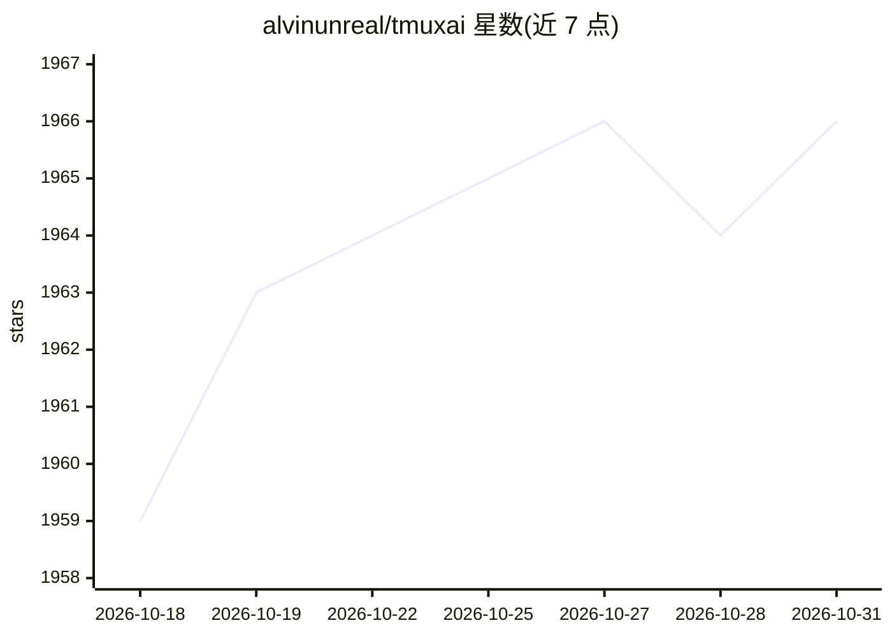

# alvinunreal/tmuxai

⭐ 1,966 · Go · Apache-2.0 · 推送 2026-10-30 · [GitHub](https://github.com/alvinunreal/tmuxai) · [官网](https://tmuxai.dev) · 个人维护

**驻留 tmux 会话的终端 AI 助手，读屏并代执行命令**

运行在 tmux 内的终端助手：读取当前窗口所有可见 pane 的内容作为上下文，通过独立 Chat Pane 对话，在获得确认后于指定 Exec Pane 执行命令并回读结果。支持三种工作模式——Observe（观察-建议-执行循环）、Prepare（定制 shell 提示符以精确追踪命令退出码）、Watch（按用户设定目标持续监控终端并给建议）。内置上下文压缩（squashing）、命令白/黑名单与风险提示、markdown 知识库加载。通过安装脚本、预编译二进制或 go install 安装，仅依赖 tmux，模型经 config.yaml 配置，支持 openrouter/requesty/openai/azure 提供方。

## 筛选速览

| 维度 | 判定 | 备注 |
|---|---|---|
| AI 角色 | `ai-native` | 本体是模型或模型工具 |
| 许可风险 | `permissive` | Apache-2.0 |
| 部署形态 | `desktop` | 安装包/桌面程序 |
| 模型依赖 | locked-api |  |
| 硬件要求 | — | 无带数字的原话,不猜 |
| 安装摩擦 | `low` | 无编译、无系统依赖或容器化 |
| 成熟度 | — | 结构信号不足 |

## 能力要点

- 读取所有可见 pane 内容作为上下文，专用 Exec Pane 代执行命令
- Observe/Prepare/Watch 三种工作模式
- 上下文达到 80% 自动 squashing 压缩对话历史
- markdown 知识库可手动或启动时自动加载

## 适用场景

- 在 tmux 中让 AI 观察终端上下文并代为执行命令
- 让 AI 持续监控日志输出并提示错误
- 沉淀项目工作流为知识库供 AI 跨会话使用

## 场景标签

`AI 助手` · 领域:对话与助手

## 证据(README 行号)

> L32: TmuxAI is an intelligent terminal assistant that lives inside your tmux sessions. Unlike other CLI AI tools, TmuxAI
> L142: 3. **TmuxAI processes your request** by sending user's message, the current pane context, and chat history to the 

## 星数曲线

2026-10-18 1,959 → 2026-10-31 1,966（+7）

---
*卡片 v1 · prompt 1.4 · 生成 2026-10-21 · 置信度 mid · 依据 README sha `0b8fee1a524e` · [字段定义](../../DATASET.md)*
