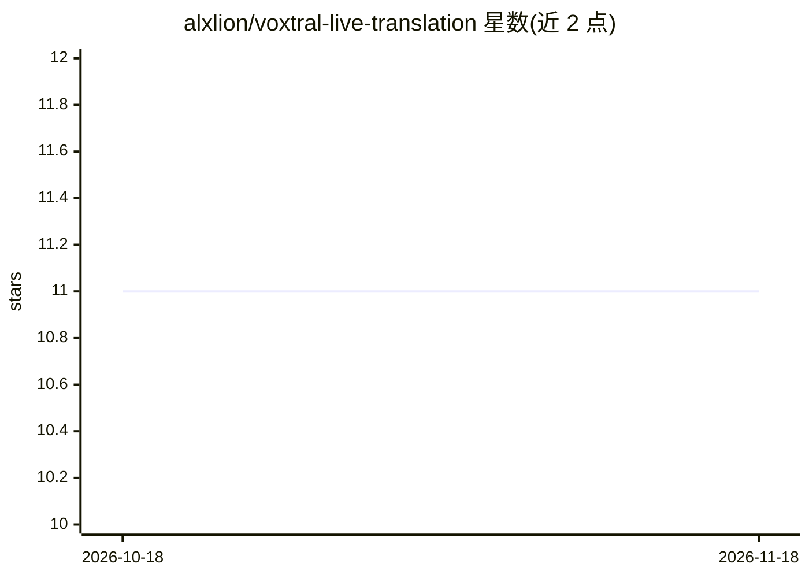

# alxlion/voxtral-live-translation

⭐ 11 · Astro · 推送 2026-03-23 · [GitHub](https://github.com/alxlion/voxtral-live-translation) · [官网](https://live-translation.alexandrelion.com) · 个人维护

**麦克风语音的实时转录与翻译 Web 应用**

基于 Voxtral-Mini-4B-Realtime 与 DeepL API 的实时语音转录翻译应用：通过 Web Audio API 采集麦克风音频并以 PCM 流式传至服务端，经 Mistral 的 Voxtral 实时 WebSocket API 转写为文本，再由 DeepL 翻译到 11 种目标语言之一。以 Astro SSR 构建，支持 npm 本地安装与 Docker 运行，API key 可写入 .env 或在浏览器设置中存入 localStorage。需 Node.js 22+、Mistral AI 与 DeepL 的 API key（DeepL 免费套餐可用）。

## 筛选速览

| 维度 | 判定 | 备注 |
|---|---|---|
| AI 角色 | `ai-native` | 本体是模型或模型工具 |
| 许可风险 | `none` | — |
| 部署形态 | `self-host` | docker 或自建部署 |
| 模型依赖 | — | README 未给出锁定关系 |
| 硬件要求 | — | 无带数字的原话,不猜 |
| 安装摩擦 | `low` | 无编译、无系统依赖或容器化 |
| 成熟度 | — | 结构信号不足 |

## 能力要点

- 麦克风音频流式转写并即时翻译，支持 11 种语言
- Voxtral 实时 WebSocket API 转写 + DeepL 翻译的流水线
- API key 可在浏览器设置中输入并存于 localStorage
- 提供 Docker 镜像构建与运行方式

## 适用场景

- 跨语言会议或对话时的实时语音翻译
- 边说边看实时转录文本并得到目标语言译文
- 以中文、日语等 11 种语言为目标语进行口译辅助

## 场景标签

`语音识别` · 领域:感知与多模态

## 证据(README 行号)

> L3: Real-time speech transcription and translation powered by Mistral AI (Voxtral) and DeepL.
> L40: 2. **Real-time transcription** - The server forwards audio to Mistral's Voxtral realtime WebSocket API for live spe
> L41: 3. **Translation** - Transcribed segments are sent to DeepL for translation into the selected target language

## 星数曲线

2026-10-18 11 → 2026-11-18 11（+0）

---
*卡片 v1 · prompt 1.4 · 生成 2026-11-18 · 置信度 high · 依据 README sha `cc0772bb0925` · [字段定义](../../DATASET.md)*
