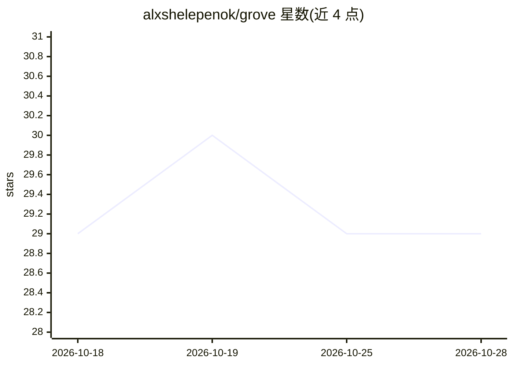

# alxshelepenok/grove

⭐ 29 · Rust · AGPL-3.0 · 推送 2026-10-27 · [GitHub](https://github.com/alxshelepenok/grove) · 个人维护

**面向 AI 编码代理的机器强制工作流协议，任务需可验证证据才能关闭**

Grove 是一套约束 AI 编码代理的工作流协议：将项目状态组织为带类型边的推理图（Area/Goal/Work/Decision/Question/Assumption/Discovery 八类节点），以确定性不变量存储于校验和锁文件中。代理在无证据记录时无法将工作项标记为完成，未满足 Definition of Ready 的任务无法启动；状态更新通过原子化 fitness 增量进行。提供 CLI、内置 MCP 服务器、桌面应用与可即插的 agent 技能包，兼容 Claude Code、Codex、Gemini CLI、Cursor、Windsurf、Cline、GitHub Copilot 等代理。Discovery 与 Delivery 双轨并行。限制：桌面应用为实验性且未在 macOS 上测试，CLI 与 MCP 服务器为稳定接口。

## 筛选速览

| 维度 | 判定 | 备注 |
|---|---|---|
| AI 角色 | `ai-ecosystem` | LLM/agent 周边工具 |
| 许可风险 | `viral` | AGPL-3.0 |
| 部署形态 | `None` |  |
| 模型依赖 | — | README 未给出锁定关系 |
| 硬件要求 | — | 无带数字的原话,不猜 |
| 安装摩擦 | `low` | 无编译、无系统依赖或容器化 |
| 成熟度 | `idea` | |

## 能力要点

- 八类节点（Area/Goal/Work/Decision/Question/Assumption/Discovery 等）组成带机器可校验边的类型化推理图
- 确定性不变量存于单一校验和锁文件：无证据不能标记完成，DoR 未满足不能开工
- 提供 CLI（grove next/grove packet）、内置 MCP 服务器、桌面应用与 agent 技能包
- causality cone 映射前置依赖与变更影响范围

## 适用场景

- 跨会话、跨代理的长周期重构或多会话功能开发
- 安全与合规等需要审计轨迹的工作追踪决策与假设
- 让不同客户端/模型的代理从已验证状态接力继续任务
- 单次提示让代理对整个代码库做 Discovery 阶段分析并构建推理图

## 场景标签

`工作流自动化` `编码 Agent` · 领域:效率与自动化

## 证据(README 行号)

> L42: Works with Claude Code, Codex, Gemini CLI, Cursor, Windsurf, Cline, GitHub
> L43: Copilot, and any other agent. **Grove includes a CLI, a built-in MCP server, and

## 星数曲线

2026-10-18 29 → 2026-10-28 29（+0）

---
*卡片 v1 · prompt 1.4 · 生成 2026-10-26 · 置信度 high · 依据 README sha `8cfff507e379` · [字段定义](../../DATASET.md)*
