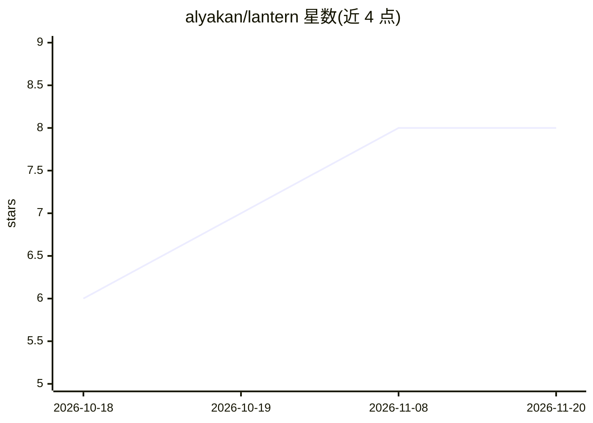

# alyakan/lantern

⭐ — · [GitHub]() · 个人维护

**macOS 图形客户端：让开发者逐步审查 Claude Code 的操作**

面向已使用 claude CLI 的开发者的 Mac 桌面应用（Tauri 构建），将 Claude Code 的工具调用以卡片、文件编辑以 diff 呈现，并逐步暂停等待用户批准。功能覆盖多项目看板、iPhone/iPad 配套应用（经 Wi-Fi 或 Tailscale 配对）、多 agent 画布（各 agent 独立 git worktree）、侧边栏（文件/测试/PR 检查/网络抓包）等。安装依赖已有的 claude CLI 并已登录；主应用 MIT 许可，mobile/ 目录下的手机应用为 PolyForm Noncommercial 许可，商业使用需获授权。

## 筛选速览

| 维度 | 判定 | 备注 |
|---|---|---|
| AI 角色 | `ai-ecosystem` | LLM/agent 周边工具 |
| 许可风险 | `permissive` | — |
| 部署形态 | `desktop` | 安装包/桌面程序 |
| 模型依赖 | — | README 未给出锁定关系 |
| 硬件要求 | — | 无带数字的原话,不猜 |
| 安装摩擦 | `low` | 无编译、无系统依赖或容器化 |
| 成熟度 | — | 结构信号不足 |

## 能力要点

- 工具调用卡片化、编辑以 diff 展示，逐步审查并 Allow/Deny
- 多 agent 画布协作，每个 agent 独立 git worktree 与分支
- iPhone/iPad 配套应用远程审批与通知
- 磁盘清理扫描与菜单栏内存/磁盘实时读数

## 适用场景

- 逐步审查并批准 Claude Code 的每次代码修改
- 在手机上远程批准 Claude 的提问与操作
- 用多个 agent 分工并行开发并决定分支合并

## 场景标签

`多智能体` `编码 Agent` · 领域:Agent 开发

## 证据(README 行号)

> L7: A Mac app for the `claude` CLI you already have: see what Claude is doing as cards and diffs, and steer it one revie
> L27: Lantern needs macOS and Claude Code, installed and logged in. Lantern runs your `claude` CLI and never handles auth
> L40: - License: MIT. The phone app in `mobile/` is source-available under the PolyForm Noncommercial License 1.0.0: free

## 星数曲线

2026-10-18 6 → 2026-11-20 8（+2）

---
*卡片 v1 · prompt 1.4 · 生成 2026-11-20 · 置信度 high · 依据 README sha `6502ea91a234` · [字段定义](../../DATASET.md)*
