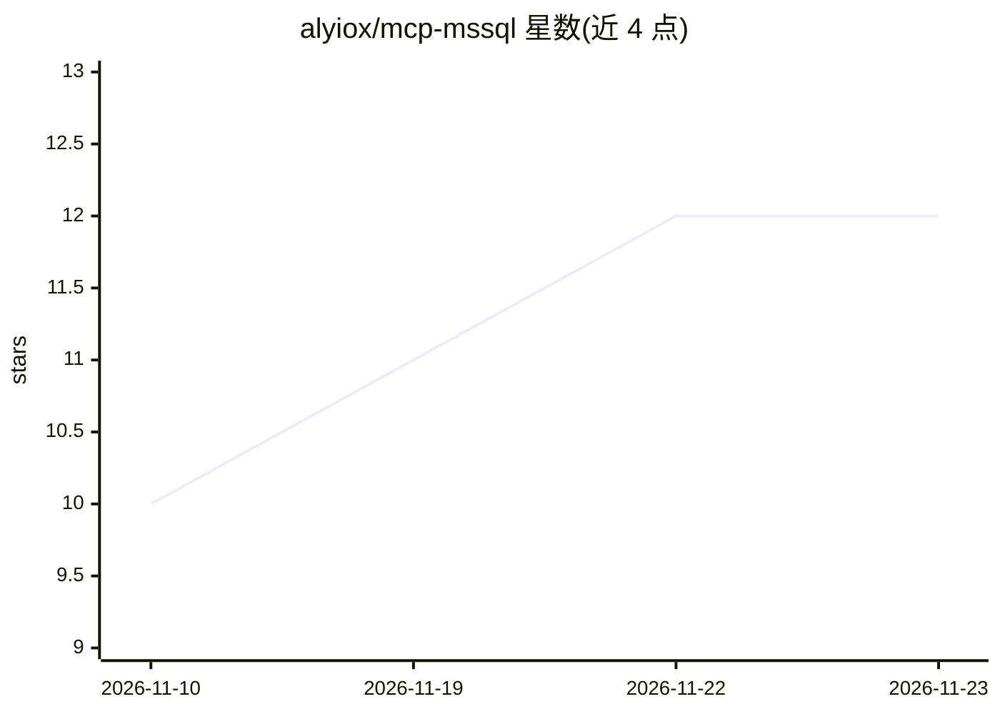

# alyiox/mcp-mssql

⭐ 12 · C# · MIT · 推送 2026-10-26 · [GitHub](https://github.com/alyiox/mcp-mssql) · 个人维护

**只读优先的 MCP 服务器：让 LLM 安全查询 SQL Server**

基于 .NET 实现的 Model Context Protocol 服务器，连接一个或多个 SQL Server。默认只读：提供 schema 发现、仅 SELECT 查询（ScriptDom 解析校验）、执行计划分析；写入需显式开启 AllowWrite，开启前 run_command 工具不注册。支持多 profile 配置（appsettings.json/环境变量/user-secrets 合并）、行数与超时上限、Microsoft Entra 认证、MCP Tasks 长任务轮询。要求 .NET 10 运行时与连接字符串。

## 筛选速览

| 维度 | 判定 | 备注 |
|---|---|---|
| AI 角色 | `ai-ecosystem` | LLM/agent 周边工具 |
| 许可风险 | `permissive` | MIT |
| 部署形态 | `library` | 以包/库形式分发 |
| 模型依赖 | — | README 未给出锁定关系 |
| 硬件要求 | — | 无带数字的原话,不猜 |
| 安装摩擦 | `medium` | 含编译或系统依赖之一 |
| 成熟度 | — | 结构信号不足 |

## 能力要点

- 默认只读：SELECT 语句经 ScriptDom 解析校验，拒绝多语句与副作用形式
- 写入 opt-in：AllowWrite=false 时 run_command 完全不注册
- 多 profile 管理，支持 appsettings.json、环境变量与 user-secrets 三源合并
- 执行计划分析返回精简 JSON（cost、missing_indexes、waits），完整 XML 可按 ID 取回

## 适用场景

- 让 Claude Code/Cursor 等 MCP 宿主安全查询公司 SQL Server
- 让 AI 助手分析慢查询的执行计划与缺失索引
- 多数据库环境下按 profile 切换连接并控制写权限

## 场景标签

 · 领域:数据库/LLM 工具集成

## 证据(README 行号)

> L7: A read-only-by-default Model Context Protocol (MCP) server for Microsoft SQL Server that provides schema discovery, 
> L9: **Requirements:** .NET 10.0 or later runtime, SQL Server, and a connection string.
> L151: **Writes are opt-in, and invisible until then.** The `run_command` tool executes arbitrary T-SQL. Unless at least 

## 星数曲线

2026-11-10 10 → 2026-11-23 12（+2）

---
*卡片 v1 · prompt 1.4 · 生成 2026-11-19 · 置信度 high · 依据 README sha `f0b97618ef95` · [字段定义](../../DATASET.md)*
