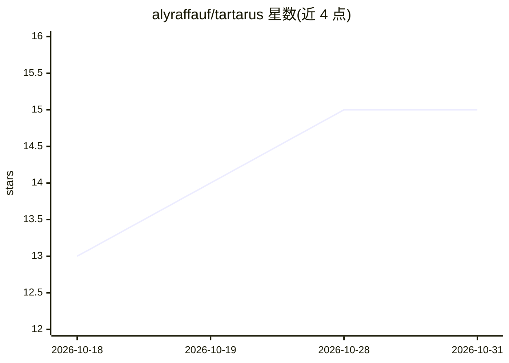

# alyraffauf/tartarus

⭐ 15 · Python · BSD-3-Clause · 推送 2026-10-28 · [GitHub](https://github.com/alyraffauf/tartarus) · 个人维护

**用 Nix 声明式定义并沙箱运行 AI agent 的实验性框架**

面向开发者的 agent 构建框架：以 Nix 模块声明 agent 的工具、模型、权限与提示词，Nix 编译出自包含 bundle，运行时由 harness 消费；策略代理（policy broker）在 bubblewrap 沙箱中执行每次工具调用，按声明授予二进制、网络主机与写权限。支持 auto/ask-once/ask-always/deny 四种审批策略、会话持久化与 JSONL 审计日志。限制：仅 Linux 可运行沙箱、仅支持 OpenAI 兼容后端、工具串行执行、网络沙箱基于代理而非防火墙。作者自述为实验性框架。

## 筛选速览

| 维度 | 判定 | 备注 |
|---|---|---|
| AI 角色 | `ai-ecosystem` | LLM/agent 周边工具 |
| 许可风险 | `permissive` | BSD-3-Clause |
| 部署形态 | `library` | 以包/库形式分发 |
| 模型依赖 | — | README 未给出锁定关系 |
| 硬件要求 | — | 无带数字的原话,不猜 |
| 安装摩擦 | `low` | 无编译、无系统依赖或容器化 |
| 成熟度 | `idea` | |

## 能力要点

- Nix 声明式定义 agent，编译为可复制的自包含闭包
- 工具调用全部经策略代理在 bubblewrap 沙箱中执行
- 细粒度授权：按能力授予包、网络主机白名单与写作用域
- 每次工具调用追加 JSONL 审计记录，支持会话恢复

## 适用场景

- 以可复现方式定义和分享带最小权限工具集的编码 agent
- 在沙箱中运行 agent 并留存每次工具调用的审计日志
- 将 agent 打包为 Nix 闭包分发到其他机器运行

## 场景标签

`Agent 框架` · 领域:Agent 开发

## 证据(README 行号)

> L3: An experimental framework for building composable, hermetic, and shareable AI agents in Nix.
> L5: Define an agent's tools, model, permissions, and prompt the same way you configure NixOS.
> L7: A policy broker runs every tool call in a sandbox, granting only the access you declared.

## 星数曲线

2026-10-18 13 → 2026-10-31 15（+2）

---
*卡片 v1 · prompt 1.4 · 生成 2026-10-30 · 置信度 mid · 依据 README sha `0113f8d707e8` · [字段定义](../../DATASET.md)*
