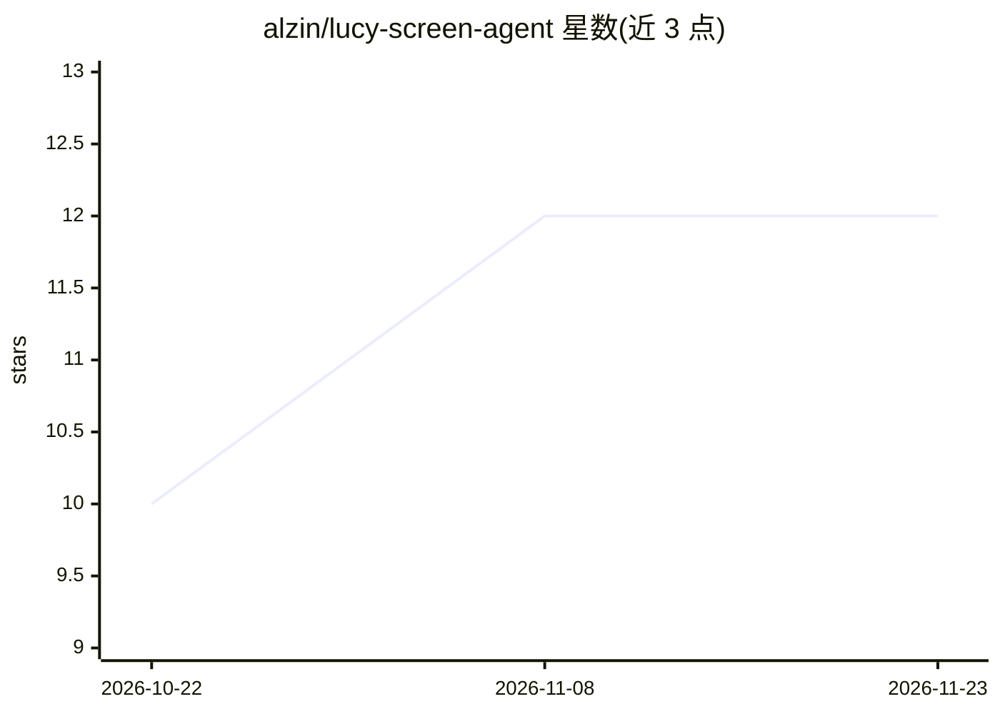

# alzin/lucy-screen-agent

⭐ 12 · Dart · MIT · 推送 2026-11-01 · [GitHub](https://github.com/alzin/lucy-screen-agent) · [官网](https://github.com/alzin/lucy-screen-agent/releases/latest/download/lucy-latest.apk) · 个人维护

**Android 屏幕感知语音 agent：看屏理解并代你点击输入**

Flutter/Kotlin 编写的 Android 应用，通过语音指令驱动 GUI 自动化：语音转文字后截取屏幕，读取无障碍树（含每个元素的像素边界），将截图与 UI 树一并发给 Google Gemini，模型返回按元素 ID 的单个动作，经无障碍服务执行真实点击/输入，循环最多 50 步直至任务完成，再以 TTS 播报结果。按元素 ID 而非猜测坐标点击。需屏幕捕获与无障碍两项高敏感权限，自备 Gemini API key 存于本机；README 自述为实验性研究项目，无 iOS 版本。

## 筛选速览

| 维度 | 判定 | 备注 |
|---|---|---|
| AI 角色 | `ai-native` | 本体是模型或模型工具 |
| 许可风险 | `permissive` | MIT |
| 部署形态 | `desktop` | 安装包/桌面程序 |
| 模型依赖 | — | README 未给出锁定关系 |
| 硬件要求 | — | 无带数字的原话,不猜 |
| 安装摩擦 | `medium` | 含编译或系统依赖之一 |
| 成熟度 | `idea` | |

## 能力要点

- 截图+无障碍树双输入，Gemini 返回按 ID 的动作避免坐标猜测
- Observe→decide→act→re-observe 代理循环，单命令最多 50 步
- 支持英/日/阿三语，含语音语言检测与匹配的 TTS/STT
- BYOK：API key 仅存本机，无后端无遥测

## 适用场景

- 驾驶时语音完成回消息、切歌、导航等操作
- 手部不便（震颤/关节炎/打石膏）场景代为操作手机
- 双手被占用（做饭/园艺/抱孩子）时免手操作
- 将跨多个应用的多步操作压缩成一句话指令

## 场景标签

`GUI 自动化` `语音 Agent` · 领域:效率与自动化

## 证据(README 行号)

> L5: **Lucy sees your screen, understands what's on it, and taps, types and swipes for you — all from a voice command.**
> L47: 4. 🤖 Send the screenshot **and** the UI tree to Google Gemini, which replies with a single next action
> L80: |🔄 **Agentic loop**|Observe → decide → act → re-observe, up to 50 steps per command.|

## 星数曲线

2026-10-22 10 → 2026-11-23 12（+2）

---
*卡片 v1 · prompt 1.4 · 生成 2026-11-18 · 置信度 high · 依据 README sha `d2a8e5dd5591` · [字段定义](../../DATASET.md)*
