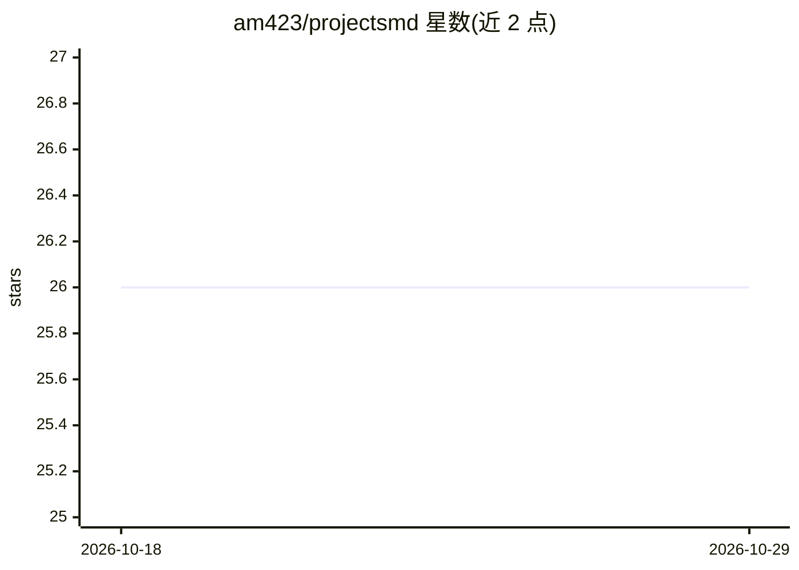

# am423/projectsmd

⭐ 26 · Rust · MIT · 推送 2026-04-30 · [GitHub](https://github.com/am423/projectsmd) · 个人维护

**单文件项目管理的 CLI：让 agent 跨会话延续项目上下文**

Rust 编写的单二进制 CLI，通过一个 project.md 文件（YAML frontmatter + 12 个结构化章节）记录项目从定义到交付的全部信息。提供 init/task/decide/discover/phase/session/next/validate/archive 等命令，支持需求三层生命周期（Validated/Active/Out of Scope）与决策结果追踪。内置符合 agentskills.io 标准的 agent 技能，可自动检测框架（如 Claude Code）安装，让 agent 在会话开始时读取状态与下一步动作，会话结束时写入总结。无数据库、无 Web、无外部服务。

## 筛选速览

| 维度 | 判定 | 备注 |
|---|---|---|
| AI 角色 | `ai-ecosystem` | LLM/agent 周边工具 |
| 许可风险 | `permissive` | MIT |
| 部署形态 | `library` | 以包/库形式分发 |
| 模型依赖 | — | README 未给出锁定关系 |
| 硬件要求 | — | 无带数字的原话,不猜 |
| 安装摩擦 | `low` | 无编译、无系统依赖或容器化 |
| 成熟度 | — | 结构信号不足 |

## 能力要点

- 单一 project.md 文件承载项目全部状态，单二进制运行
- 需求三层生命周期（Validated/Active/Out of Scope）与决策结果追踪
- 内置 agentskills.io 标准 agent 技能，自动检测框架安装
- validate 命令检查文件与规范的符合性，支持 JSON 输出

## 适用场景

- 让 AI agent 在新会话中直接续接上次工作进度
- 人与 agent 协作时统一记录任务、决策与发现
- 对已有代码库（brownfield）导入并初始化项目规范文件

## 场景标签

`Agent 记忆` · 领域:Agent 开发

## 证据(README 行号)

> L5: `projectsmd` is a single binary that manages `project.md` files — one markdown file that captures everything about a
> L361: projectsmd skill install --framework claude  # For Claude Code

## 星数曲线

2026-10-18 26 → 2026-10-29 26（+0）

---
*卡片 v1 · prompt 1.4 · 生成 2026-10-26 · 置信度 high · 依据 README sha `074fb9d4d834` · [字段定义](../../DATASET.md)*
