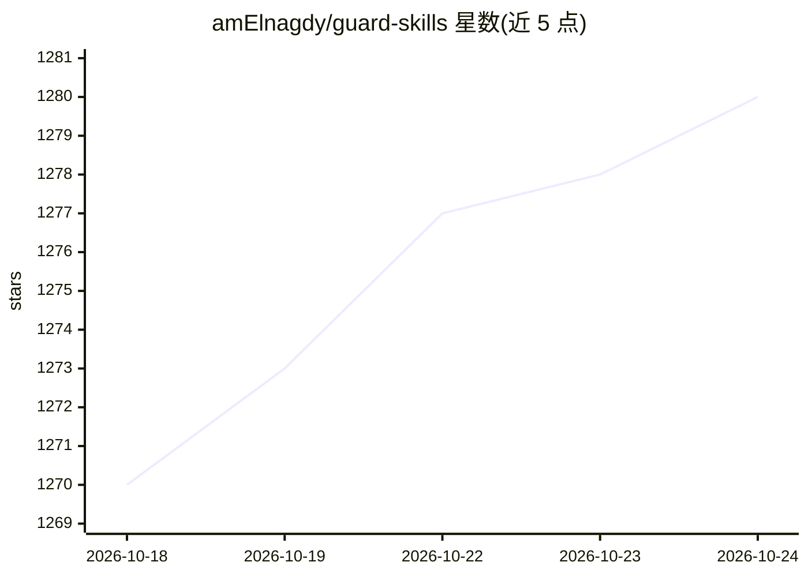

# amElnagdy/guard-skills

⭐ 1,283 · MIT · 推送 2026-07-04 · [GitHub](https://github.com/amElnagdy/guard-skills) · [官网](https://skills.sh/amElnagdy/guard-skills) · 个人维护

**给编码 agent 的守卫技能包：审查 AI 生成的代码、测试与文档**

面向 Claude Code、Codex、Cursor、OpenCode 等编码 agent 的技能包（skills.sh 格式），提供 5 个守卫技能：clean-code-guard 检查 LLM 代码坏味道、test-guard 检查测试代码问题、docs-guard 校验文档声明与代码一致性、wp-guard 与 woo-guard 针对 WordPress/WooCommerce 交付规范。定位为 agent 产出工作后的第二道质量门，在提交或合并前对 diff 做响应式审查。通过 npx skills CLI 安装，内容为 Markdown 加轻量元数据，无可执行脚本与网络调用。

## 筛选速览

| 维度 | 判定 | 备注 |
|---|---|---|
| AI 角色 | `ai-ecosystem` | LLM/agent 周边工具 |
| 许可风险 | `permissive` | MIT |
| 部署形态 | `library` | 以包/库形式分发 |
| 模型依赖 | — | README 未给出锁定关系 |
| 硬件要求 | — | 无带数字的原话,不猜 |
| 安装摩擦 | `low` | 无编译、无系统依赖或容器化 |
| 成熟度 | — | 结构信号不足 |

## 能力要点

- 5 个守卫技能：clean-code / test / docs / wp / woo
- 针对 AI 生成代码的系统性失败模式（幻觉 API、mock 滥用、文档漂移）
- 每个技能含 SKILL.md 入口与渐进式披露的参考文件
- 内容仅为 Markdown 与元数据，无可执行脚本与网络调用

## 适用场景

- agent 写完代码后、提交合并前做第二道质量审查
- 检查 AI 生成的测试是否真的能捕获缺陷
- 校验生成的 README 与 API 文档是否与代码一致
- WordPress/WooCommerce 插件开发中的安全与规范检查

## 场景标签

`代码审查` · 领域:编码与开发

## 证据(README 行号)

> L5: Focused **guard skills** for coding agents: second-pass quality gates that catch the systematic failure modes of AI-
> L47: Works with Claude Code, Codex, Cursor, OpenCode, and other supported agents via the Skills CLI.

## 星数曲线

2026-10-18 1,270 → 2026-10-24 1,280（+10）

---
*卡片 v1 · prompt 1.4 · 生成 2026-10-21 · 置信度 high · 依据 README sha `c3b29feb1011` · [字段定义](../../DATASET.md)*
