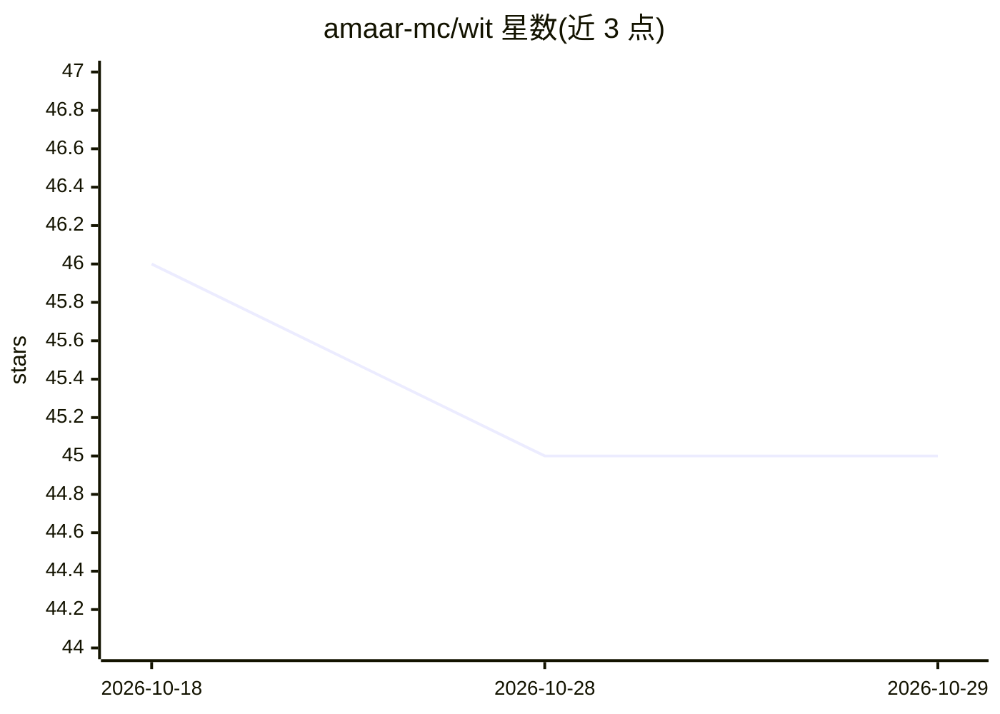

# amaar-mc/wit

⭐ 45 · TypeScript · MIT · 推送 2026-03-27 · [GitHub](https://github.com/amaar-mc/wit) · 个人维护

**多 AI 编码代理共享代码库的冲突预防协调协议**

面向多个 AI 编码代理同时操作同一仓库的场景，Wit 在代理与 git 之间运行一个 Bun 守护进程，代理通过 Unix 套接字以 JSON-RPC 声明工作意图、按符号（函数/类/类型，经 Tree-sitter 解析）加锁、接收冲突警告并约定函数签名契约。意图与锁仅为警告不阻断，契约则由 git pre-commit 钩子强制执行。以 Claude Code 插件与通用 CLI 提供，支持 TypeScript/JavaScript/Python，v1 限单机、依赖 Bun 运行时。

## 筛选速览

| 维度 | 判定 | 备注 |
|---|---|---|
| AI 角色 | `ai-ecosystem` | LLM/agent 周边工具 |
| 许可风险 | `permissive` | MIT |
| 部署形态 | `None` |  |
| 模型依赖 | locked-api |  |
| 硬件要求 | — | 无带数字的原话,不猜 |
| 安装摩擦 | `low` | 无编译、无系统依赖或容器化 |
| 成熟度 | `idea` | |

## 能力要点

- 守护进程 + JSON-RPC 协议（12 个方法，附 OpenRPC 规范）
- Tree-sitter 符号级语义锁，支持 TS/JS/Python
- 意图重叠/锁交叉/依赖链三重冲突检测，默认仅警告
- 函数签名契约由 git pre-commit 钩子强制执行

## 适用场景

- 多个 Claude Code / Cursor / Copilot 代理并行开发同一仓库时预防合并冲突
- 为自定义 AI 编码代理按 JSON-RPC 规范接入协调协议
- 通过契约机制保证代理间约定的函数签名不被破坏

## 场景标签

 · 领域:开发者工具/AI 代理基础设施

## 证据(README 行号)

> L14: **Wit** coordinates multiple AI coding agents working on the same repository simultaneously. It sits between your a
> L26: Wit runs a lightweight daemon in the background. Agents communicate with it over a Unix socket using JSON-RPC. The 
> L215: Any AI coding tool that can POST JSON to a Unix socket or run a shell command can participate in the coordination 

## 星数曲线

2026-10-18 46 → 2026-10-29 45（-1）

---
*卡片 v1 · prompt 1.4 · 生成 2026-10-25 · 置信度 high · 依据 README sha `b1d9d53f9975` · [字段定义](../../DATASET.md)*
