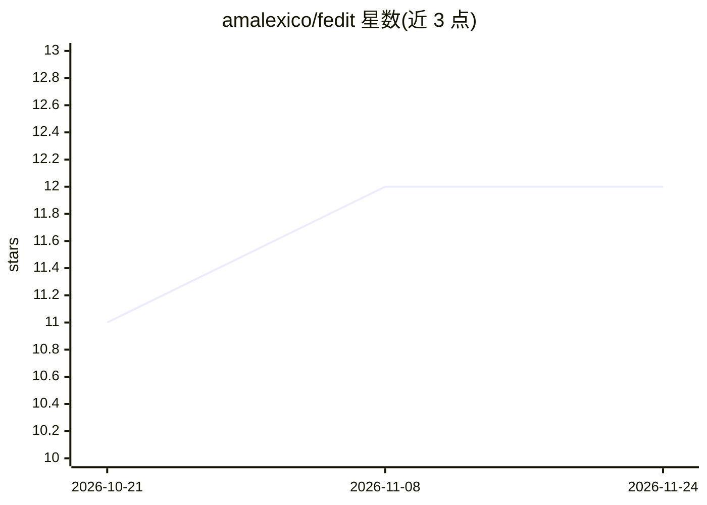

# amalexico/fedit

⭐ 12 · Go · MIT · 推送 2026-11-06 · [GitHub](https://github.com/amalexico/fedit) · [官网](https://amalexhandler.com/fedit) · 个人维护

**面向 LLM 辅助编程的命令行文件编辑工具**

纯 Go 编写的零依赖 CLI，通过子命令对文件执行 show、find、insert、replace、replaceall、delete、write 等行级编辑操作，每次修改可经 -v 或默认的磁盘重读验证并输出 VERIFY: PASS/FAIL 与退出码。支持多文件 glob/逗号列表批处理、跨文件 copy/move/replace（-dest）、CSV/TSV 列提取、多 GB 文件的流式模式，并提供 MCP 服务器（fedit_replaceall 等工具）供编码代理调用。定位系统管理员、DevOps 工程师等脚本化改配置的用户。

## 筛选速览

| 维度 | 判定 | 备注 |
|---|---|---|
| AI 角色 | `ai-enhanced` | 去掉 AI 部分产品仍成立 |
| 许可风险 | `permissive` | MIT |
| 部署形态 | `desktop` | 安装包/桌面程序 |
| 模型依赖 | — | README 未给出锁定关系 |
| 硬件要求 | — | 无带数字的原话,不猜 |
| 安装摩擦 | `low` | 无编译、无系统依赖或容器化 |
| 成熟度 | — | 结构信号不足 |

## 能力要点

- 行级编辑操作带默认验证与退出码（0/1/3）
- 21 种语言的结构映射（map），多文件 glob/列表批处理
- -stream 逐行处理多 GB 文件，临时文件原子写入
- 提供 MCP 工具集（fedit_replaceall、fedit_insertafter 等）供 LLM 代理调用

## 适用场景

- 脚本化批量修改服务器配置文件并验证结果
- 在 LLM 编码代理中以工具形式精确编辑文件行
- 流式替换多 GB 日志文件中的字符串
- 提取 CSV/TSV 指定列而无需 awk

## 场景标签

 · 领域:开发者工具/CLI

## 证据(README 行号)

> L5: A zero-dependency CLI tool for **surgical file edits** from the command line.
> L122: - Every replaceall is verified by default: after the write, fedit re-reads the file from disk and prints `VERIFY: 
> L227: - MCP: fedit_replaceall, fedit_insertafter, fedit_insertbefore, fedit_delete and fedit_replace take a comma list o

## 星数曲线

2026-10-21 11 → 2026-11-24 12（+1）

---
*卡片 v1 · prompt 1.4 · 生成 2026-11-18 · 置信度 mid · 依据 README sha `74ca03fca74b` · [字段定义](../../DATASET.md)*
