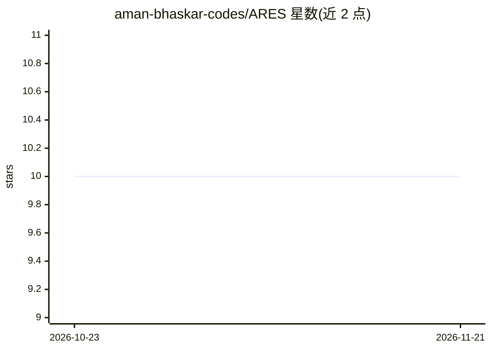

# aman-bhaskar-codes/ARES

⭐ 10 · Python · Apache-2.0 · 推送 2026-11-09 · [GitHub](https://github.com/aman-bhaskar-codes/ARES) · 个人维护

**面向研究者带引用溯源的自主研究与证据检索工作台**

一个研究工作区应用：通过 SearXNG、OpenAlex、Crossref、arXiv 适配器发现网络与学术来源，进行混合检索与带引用的回答生成。FastAPI 控制平面协调持久化研究运行与后台 worker，React 前端展示答案、来源证据与执行活动。支持 Gemini 云端模型或经 Ollama 运行本地 Qwen 模型，提供 keyless 演示模式（SQLite，无需 Docker）、研究记忆持久化与 MCP 集成。声明为活跃开发中的研究应用，发布强化禁用了生成代码执行。

## 筛选速览

| 维度 | 判定 | 备注 |
|---|---|---|
| AI 角色 | `ai-native` | 本体是模型或模型工具 |
| 许可风险 | `permissive` | Apache-2.0 |
| 部署形态 | `self-host` | docker 或自建部署 |
| 模型依赖 | local-ok | 支持本地模型 |
| 硬件要求 | — | 无带数字的原话,不猜 |
| 安装摩擦 | `low` | 无编译、无系统依赖或容器化 |
| 成熟度 | — | 结构信号不足 |

## 能力要点

- 多来源发现：SearXNG、OpenAlex、Crossref、arXiv 适配器
- 可在 Gemini 与本地 Qwen（Ollama）间切换写作模型
- 回答附引用，可查看来源片段与研究活动
- MCP 集成使其他 agent 可访问研究能力

## 适用场景

- 对一个问题做带出处的网络与学术检索研究
- 上传 PDF 并在文献库中检索片段佐证回答
- 本地模型下离线使用研究工作区
- 让其他 agent 通过 MCP 调用研究能力

## 场景标签

`科研工具` `RAG` `文档问答` · 领域:知识与检索

## 证据(README 行号)

> L17: ARES brings source discovery, document retrieval, and cited answer generation into one interface. A FastAPI control
> L19: Use the keyless demo to explore the interface, or configure live research with Google Gemini or a local Qwen model 
> L27: - **Choose a writer:** switch between Gemini and local Qwen in the model menu. Ask for a brief answer or a detailed

## 星数曲线

2026-10-23 10 → 2026-11-21 10（+0）

---
*卡片 v1 · prompt 1.4 · 生成 2026-11-20 · 置信度 mid · 依据 README sha `0abc44213a84` · [字段定义](../../DATASET.md)*
