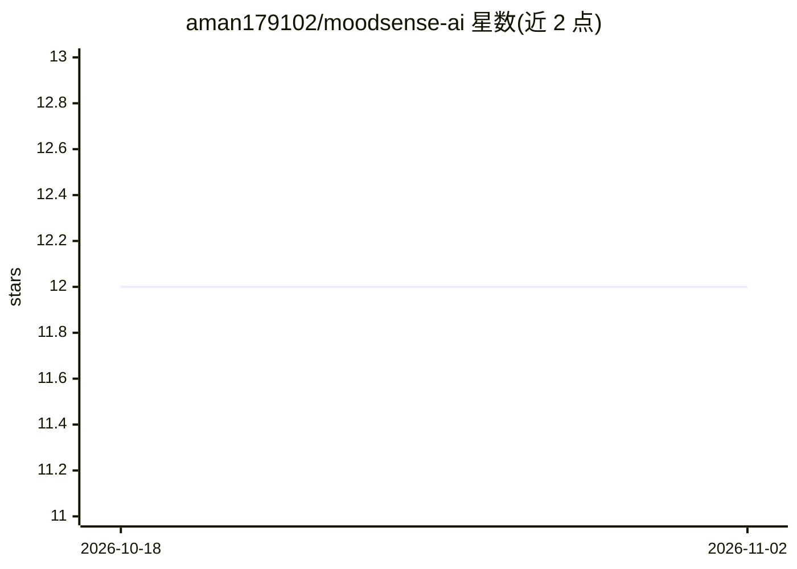

# aman179102/moodsense-ai

⭐ 12 · Python · 推送 2026-05-26 · [GitHub](https://github.com/aman179102/moodsense-ai) · [官网](https://huggingface.co/spaces/aman179102/moodsense-ai) · 个人维护

**文本情绪检测与个性化推荐的全栈应用（8 类情绪）**

基于 Python/FastAPI/Gradio 的全栈应用：读取用户文本，用 TF-IDF、句子嵌入与 Logistic Regression/Naive Bayes/LightGBM 集成模型将文本分类为 8 种情绪（happy/sad/angry 等），返回置信度与全类别概率分布，并按情绪推荐音乐、活动、电影与语录。提供 REST API（含批量预测、健康检查）、Gradio 网页界面、Prometheus 监控指标与 Docker Compose 部署；模型经 train.py 本地训练，可用自有数据或 Hugging Face/OpenAI 模型替换。

## 筛选速览

| 维度 | 判定 | 备注 |
|---|---|---|
| AI 角色 | `ai-native` | 本体是模型或模型工具 |
| 许可风险 | `none` | — |
| 部署形态 | `self-host` | docker 或自建部署 |
| 模型依赖 | — | README 未给出锁定关系 |
| 硬件要求 | — | 无带数字的原话,不猜 |
| 安装摩擦 | `low` | 无编译、无系统依赖或容器化 |
| 成熟度 | — | 结构信号不足 |

## 能力要点

- 文本分类为 8 种情绪，输出置信度与概率分布
- 按情绪推荐音乐/活动/电影/语录
- FastAPI REST API（含批量预测）+ Gradio 界面 + Prometheus 指标
- Docker Compose 一键部署，支持自有数据重训

## 适用场景

- 分析用户留言的情绪并给出内容推荐
- 作为情绪检测 API 服务集成到其他系统
- 用自己的文本数据重新训练情绪分类模型

## 场景标签

`推荐系统` · 领域:学习与行业

## 证据(README 行号)

> L20: MoodSense AI is a production-grade, full-stack application that detects emotional states from text and provides per
> L43: |**Mood Detection (NLP)**|Classifies text into 8 moods: happy, sad, angry, anxious, neutral, excited, bored, confus

## 星数曲线

2026-10-18 12 → 2026-11-02 12（+0）

---
*卡片 v1 · prompt 1.4 · 生成 2026-11-01 · 置信度 mid · 依据 README sha `0d163cbb4e02` · [字段定义](../../DATASET.md)*
