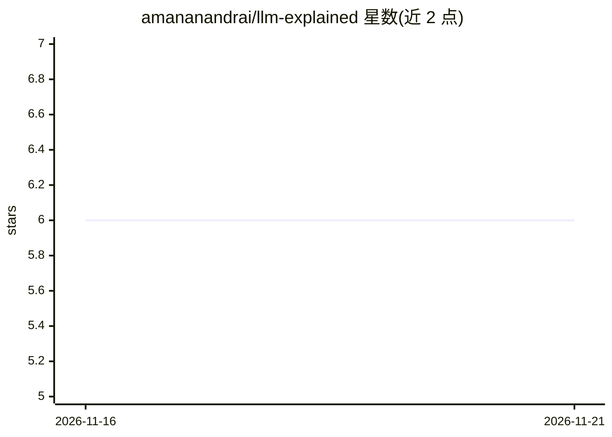

# amananandrai/llm-explained

⭐ 6 · JavaScript · MIT · 推送 2026-11-16 · [GitHub](https://github.com/amananandrai/llm-explained) · [官网](https://llm-explained-lovat.vercel.app) · 个人维护

**讲解大语言模型原理的交互式滚动课程（43 页）**

以滚动驱动动画呈现的 LLM 交互式课程网站，共 43 个页面（模块 0–41 及 KL 子页），每页含深度切换（直觉/机制/数学）、KaTeX 公式、小工具、测验与延伸阅读；附架构图谱，按三个时代绘制 transformer 结构，并为 Llama、Mistral、DeepSeek 等开源权重模型逐一生成结构图，另收录 120 个可搜索筛选的开源架构。纯静态站点无构建步骤，Python 单元经 Pyodide 在浏览器内运行；尚无真实分词器、live LLM 调用。

## 筛选速览

| 维度 | 判定 | 备注 |
|---|---|---|
| AI 角色 | `ai-knowledge` | 知识聚合/清单类 |
| 许可风险 | `permissive` | MIT |
| 部署形态 | `library` | 以包/库形式分发 |
| 模型依赖 | — | README 未给出锁定关系 |
| 硬件要求 | — | 无带数字的原话,不猜 |
| 安装摩擦 | `low` | 无编译、无系统依赖或容器化 |
| 成熟度 | — | 结构信号不足 |

## 能力要点

- 43 个交互式模块：滚动动画、公式、小工具与测验
- 架构图谱：逐块绘制三个时代的 transformer 并为开源模型生成结构图
- 120 个开源架构的可搜索画廊（数据来自 Raschka 画廊快照）
- Python 单元经 Pyodide 在浏览器内运行，站点无构建步骤

## 适用场景

- 系统学习 transformer 与 LLM 的内部机制
- 查阅各开源权重模型的架构差异与逐层结构
- 课程或自学中用交互式小工具理解 BPE、HNSW、RLHF 等概念

## 场景标签

`教程课程` · 领域:学习与行业

## 证据(README 行号)

> L5: A scroll-driven, interactive course on how large language models work, built from `plan/build-plan.md`.
> L9: - **All 43 pages interactive:** Modules 0–41 plus the Module 0 KL sub-page. Each page follows the plan's template: h

## 星数曲线

2026-11-16 6 → 2026-11-21 6（+0）

---
*卡片 v1 · prompt 1.4 · 生成 2026-11-20 · 置信度 high · 依据 README sha `f1a912ca8581` · [字段定义](../../DATASET.md)*
