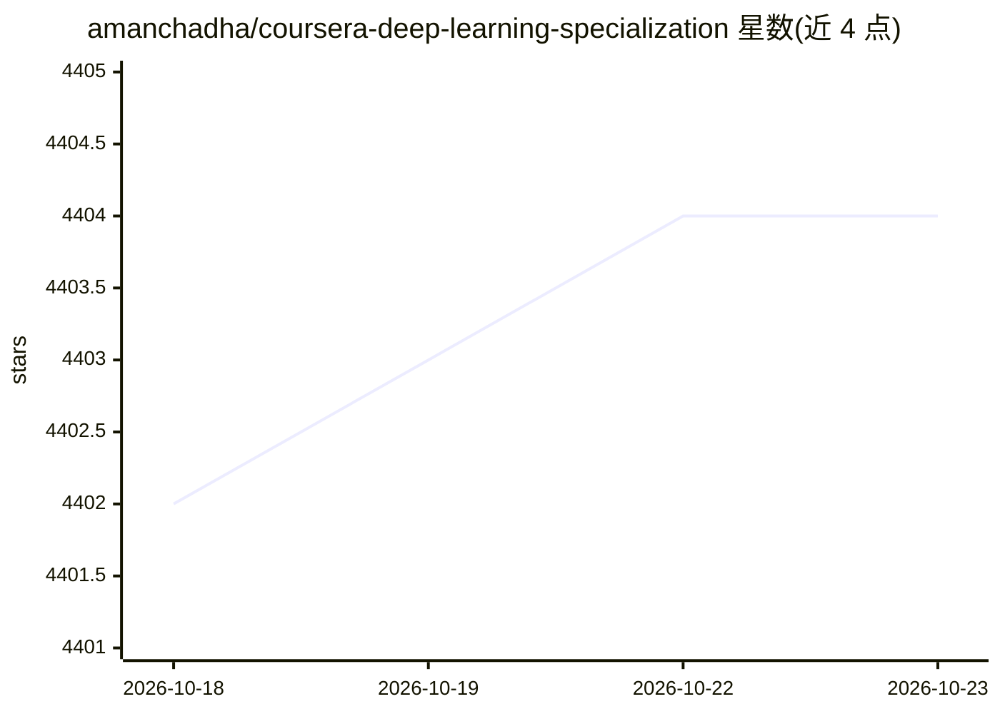

# amanchadha/coursera-deep-learning-specialization

⭐ 4,404 · Jupyter Notebook · 推送 2026-06-10 · [GitHub](https://github.com/amanchadha/coursera-deep-learning-specialization) · 个人维护

**deeplearning.ai 深度学习专项课程的作业与测验解答合集**

收录 Coursera（deeplearning.ai，讲师 Andrew Ng）Deep Learning 专项课程全部 5 门课的编程作业与测验解答：涵盖神经网络基础、超参数调优与正则化、CNN（YOLO 检测、U-Net 分割、风格迁移、人脸识别）、序列模型（RNN/LSTM/Transformer 及 NER、问答应用）等；2021 年版本已从 TensorFlow 1 迁移到 TensorFlow 2。提供 setup.sh 脚本下载预训练 VGG-19 模型与数据集，并注明解答仅供参考。面向课程学习者使用。

## 筛选速览

| 维度 | 判定 | 备注 |
|---|---|---|
| AI 角色 | `ai-knowledge` | 知识聚合/清单类 |
| 许可风险 | `none` | — |
| 部署形态 | `None` |  |
| 模型依赖 | — | README 未给出锁定关系 |
| 硬件要求 | — | 无带数字的原话,不猜 |
| 安装摩擦 | `low` | 无编译、无系统依赖或容器化 |
| 成熟度 | — | 结构信号不足 |

## 能力要点

- 覆盖 5 门课程的全部编程作业与测验解答（含 Transformer 应用）
- 2021 年版本已迁移至 TensorFlow 2
- setup.sh 一键下载预训练 VGG-19 模型与作业数据集
- README 声明解答仅供参考，不建议直接复制

## 适用场景

- 学习 Coursera 深度学习专项课程时对照参考
- 卡在作业某步时查看解题思路
- 快速浏览课程各周作业主题与知识点分布

## 场景标签

`教程课程` · 领域:学习与行业

## 证据(README 行号)

> L3: Programming assignments and quizzes from all courses in the Coursera Deep Learning specialization offered by `deeple
> L25: ### Course 1: Neural Networks and Deep Learning

## 星数曲线

2026-10-18 4,402 → 2026-10-23 4,404（+2）

---
*卡片 v1 · prompt 1.4 · 生成 2026-10-20 · 置信度 high · 依据 README sha `7e51562312e0` · [字段定义](../../DATASET.md)*
