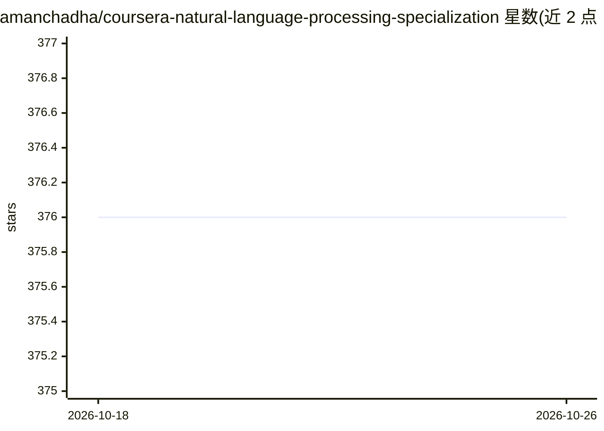

# amanchadha/coursera-natural-language-processing-specialization

⭐ 376 · Jupyter Notebook · MIT · 推送 2025-12-08 · [GitHub](https://github.com/amanchadha/coursera-natural-language-processing-specialization) · 个人维护

**deeplearning.ai NLP 专项课程的编程作业解答合集**

收录 amanchadha 在 Coursera deeplearning.ai 自然语言处理专项四门课程的全部编程作业与实验解答：从逻辑回归/朴素贝叶斯情感分析、词向量、自动纠错、隐马尔可夫词性标注、CBOW 词嵌入，到 Trax 序列模型、孪生网络、注意力机器翻译、Transformer 摘要、T5 问答与聊天机器人。README 声明解答仅供参考、不建议直接复制。仓库不含安装说明，需自行准备课程环境（TensorFlow/Trax 等）。

## 筛选速览

| 维度 | 判定 | 备注 |
|---|---|---|
| AI 角色 | `ai-knowledge` | 知识聚合/清单类 |
| 许可风险 | `permissive` | MIT |
| 部署形态 | `None` |  |
| 模型依赖 | — | README 未给出锁定关系 |
| 硬件要求 | — | 无带数字的原话,不猜 |
| 安装摩擦 | `low` | 无编译、无系统依赖或容器化 |
| 成熟度 | — | 结构信号不足 |

## 能力要点

- 覆盖 4 门课程全部编程作业与实验
- 内容涵盖从朴素贝叶斯到 Transformer/T5/Reformer 的 NLP 技术
- 作者声明解答仅供参考、不可直接复制

## 适用场景

- 学习 NLP 专项课程时卡住后参考他人解答
- 按周浏览 NLP 各主题的作业实现思路
- 了解课程覆盖的技术范围以决定是否选课

## 场景标签

`教程课程` · 领域:学习与行业

## 证据(README 行号)

> L3: Programming assignments from all courses in the Coursera Natural Language Processing Specialization offered by `deep
> L13: - Course 1: Natural Language Processing with Classification and Vector Spaces

## 星数曲线

2026-10-18 376 → 2026-10-26 376（+0）

---
*卡片 v1 · prompt 1.4 · 生成 2026-10-21 · 置信度 high · 依据 README sha `c5399361d54b` · [字段定义](../../DATASET.md)*
