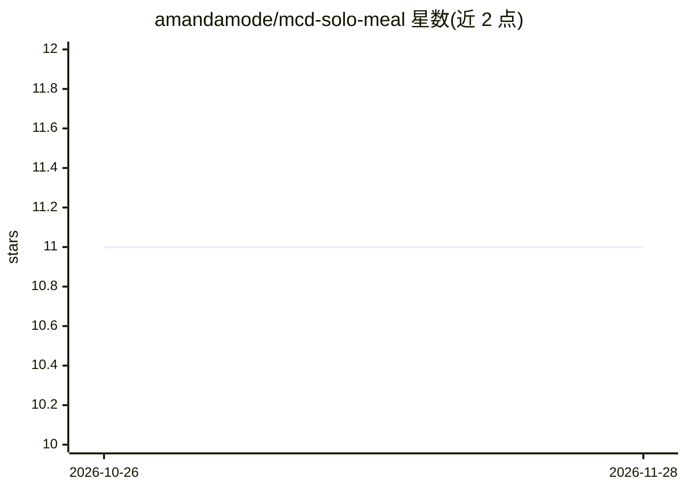

# amandamode/mcd-solo-meal

⭐ 11 · Python · 推送 2026-11-11 · [GitHub](https://github.com/amandamode/mcd-solo-meal) · 个人维护 · 中文 README

**给独居人群的麦当劳一人食点餐决策与陪伴 Skill**

以 WorkBuddy Skill 形式运行的点餐助手：按「状态双模式（极速单/犒劳单）→ 查询附近门店 → 查询餐品 → 读取真实营养数据 → 计算价格 → 推荐+陪伴文案 → 用户确认后下单」的流程执行。内置本地记忆层存口味/忌口/常点，支持基于本周已点去重的 7 天不重样菜单与节日套餐。demo 与单元测试使用内置 mock 数据，接入真实麦当劳 MCP 后餐品与营养数据由 MCP 工具实时返回。绝不自动下单。

## 筛选速览

| 维度 | 判定 | 备注 |
|---|---|---|
| AI 角色 | `ai-native` | 本体是模型或模型工具 |
| 许可风险 | `none` | — |
| 部署形态 | `None` |  |
| 模型依赖 | — | README 未给出锁定关系 |
| 硬件要求 | — | 无带数字的原话,不猜 |
| 安装摩擦 | `low` | 无编译、无系统依赖或容器化 |
| 成熟度 | — | 结构信号不足 |

## 能力要点

- 极速单/犒劳单双模式决策，生成 7 天不重样周菜单
- 本地记忆层存忌口/口味/常点
- 基于 list-nutrition-foods 真实营养数据的一句话提示
- 节日/生日检测并给出套餐与陪伴文案

## 适用场景

- 赶稿或疲惫时快速决定一个人吃什么
- 周末犒劳自己时选一份合适的套餐
- 独居一周不重样地安排餐食
- 节日期间给自己点一份像样的饭

## 场景标签

 · 领域:生活服务/餐饮

## 证据(README 行号)

> L3: 给**独居 / 一个人生活**的人（独居青年、异地工作党、自由职业、一人公司都算）的「今天一个人吃什么」决策 + 治愈陪伴 Skill。
> L36: Skill 会按 `now-time-info → query-nearby-stores → query-meals → list-nutrition-foods → calculate-price → 推荐+文案 → 确认后 
> L44: > 说明：`demo.py` 与单元测试使用内置 mock 餐品数据，无需联网即可验证三模块逻辑。接入真实麦当劳 MCP 后，餐品/营养数据由 MCP 工具实时返回。

## 星数曲线

2026-10-26 11 → 2026-11-28 11（+0）

---
*卡片 v1 · prompt 1.4 · 生成 2026-11-18 · 置信度 high · 依据 README sha `a5c6be2a9327` · [字段定义](../../DATASET.md)*
