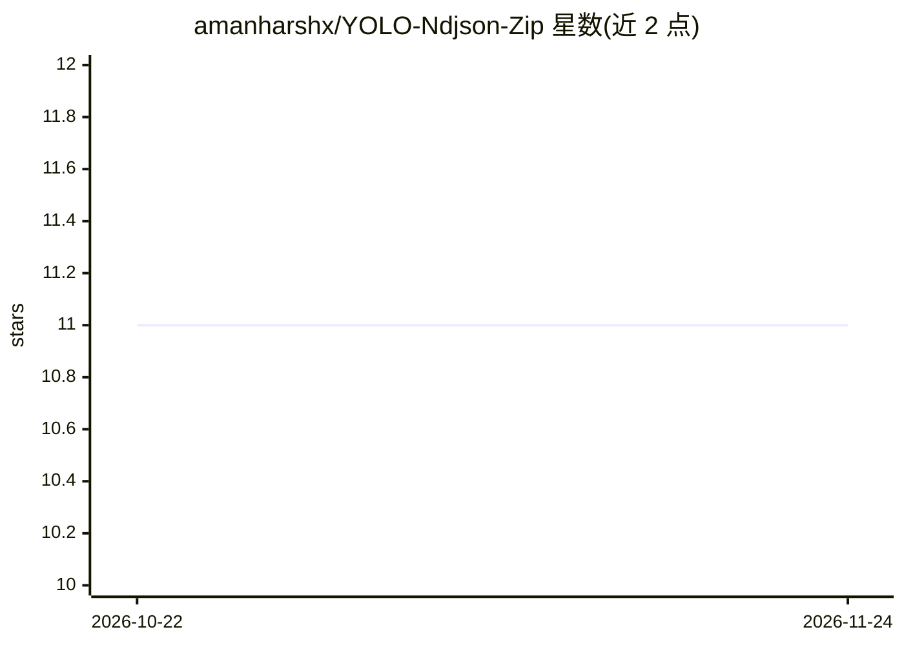

# amanharshx/YOLO-Ndjson-Zip

⭐ 11 · Rust · MIT · 推送 2026-11-02 · [GitHub](https://github.com/amanharshx/YOLO-Ndjson-Zip) · [官网](https://yolondjson.zip) · 个人维护

**把 Ultralytics NDJSON 标注导出转成 YOLO/COCO/VOC 等训练格式的本地桌面工具**

基于 Tauri + Rust 的跨平台桌面应用（约 5 MB 二进制），读取 Ultralytics NDJSON 标注导出文件，转换并打包为可直接训练的数据集 ZIP。支持 12 种输出格式（YOLOv5 至 YOLO26、COCO JSON、Pascal VOC、Darknet、TFRecord 等）与 7 类任务（检测、分割、姿态、分类、OBB、深度估计）。全部处理在本地完成，数据不上传；支持 100 并发连接拉取图片、应用内自动更新与签名校验。未做代码签名，macOS/Windows 首次运行需手动放行。

## 筛选速览

| 维度 | 判定 | 备注 |
|---|---|---|
| AI 角色 | `ai-ecosystem` | LLM/agent 周边工具 |
| 许可风险 | `permissive` | MIT |
| 部署形态 | `desktop` | 安装包/桌面程序 |
| 模型依赖 | — | README 未给出锁定关系 |
| 硬件要求 | — | 无带数字的原话,不猜 |
| 安装摩擦 | `low` | 无编译、无系统依赖或容器化 |
| 成熟度 | — | 结构信号不足 |

## 能力要点

- 12 种输出格式、7 种任务类型的标注转换，不支持的格式-任务组合在下载前即拒绝
- 全程本地处理，数据不离开设备
- 100 并发图片下载，输出即训练就绪的 ZIP
- Tauri + Rust 实现约 5 MB 体积，支持自动更新与加密签名校验

## 适用场景

- 把标注平台导出的 NDJSON 数据转成 YOLO/COCO 训练集
- 本地批量转换数据集且不泄露数据
- 为不同 YOLO 版本生成对应格式的 data.yaml 与目录结构

## 场景标签

 · 领域:机器学习工具/数据准备

## 证据(README 行号)

> L18: > Select your Ultralytics NDJSON export, pick an output format, and get a ready-to-train ZIP - everything runs loca
> L24: - **12 Output Formats** - YOLO26 through Darknet, COCO JSON, Pascal VOC, TFRecord, CreateML
> L173: - **Frontend** - React 19 + TypeScript, Tailwind CSS, Vite

## 星数曲线

2026-10-22 11 → 2026-11-24 11（+0）

---
*卡片 v1 · prompt 1.4 · 生成 2026-11-18 · 置信度 high · 依据 README sha `85b0f1af5ff2` · [字段定义](../../DATASET.md)*
