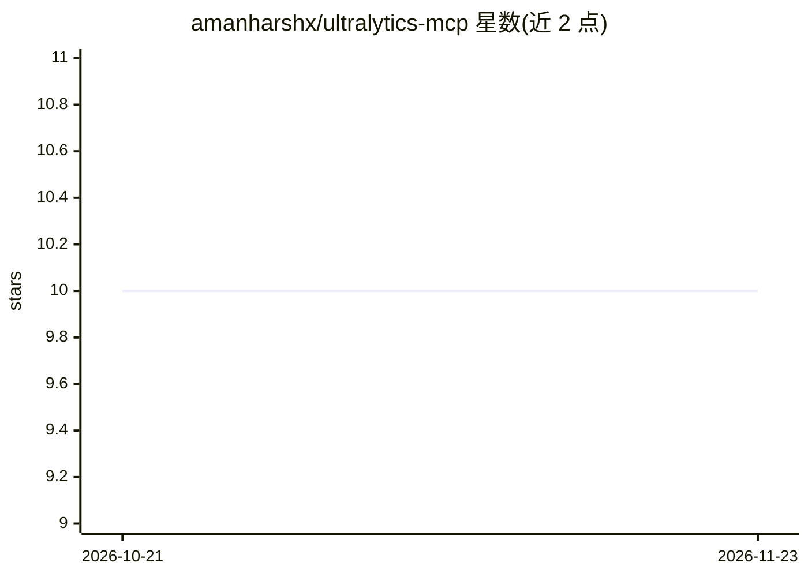

# amanharshx/ultralytics-mcp

⭐ 10 · TypeScript · MIT · 推送 2026-11-13 · [GitHub](https://github.com/amanharshx/ultralytics-mcp) · [官网](https://www.npmjs.com/package/ultralytics-mcp) · 个人维护

**给 MCP 客户端接入 Ultralytics 平台的流程与模型操作服务器**

一个独立的社区 MCP 服务器（非 Ultralytics 官方项目），让 Claude Code、Codex、Cursor、VS Code 等 MCP 客户端通过自然语言调用 Ultralytics Platform：管理项目与数据集（创建、上传、软删除）、上传本地视频数据集、启动与监控 YOLO 微调训练、运行预测、下载权重与导出。通过 npx 分发，需 Node.js ≥20 与 Ultralytics Platform API key。内置安全机制：默认私有创建、训练/导出需 confirm_cost 确认、删除进可恢复回收站、拒绝未声明参数。

## 筛选速览

| 维度 | 判定 | 备注 |
|---|---|---|
| AI 角色 | `ai-ecosystem` | LLM/agent 周边工具 |
| 许可风险 | `permissive` | MIT |
| 部署形态 | `library` | 以包/库形式分发 |
| 模型依赖 | — | README 未给出锁定关系 |
| 硬件要求 | — | 无带数字的原话,不猜 |
| 安装摩擦 | `medium` | 含编译或系统依赖之一 |
| 成熟度 | — | 结构信号不足 |

## 能力要点

- 覆盖 projects、datasets、models、training、prediction、exports 等平台工作流
- 训练/导出需 confirm_cost 显式确认，费用在任务启动后报告
- 项目与数据集默认私有，删除为 30 天可恢复软删除
- 支持 Claude Code、Codex、Cursor、VS Code、Gemini CLI 等 MCP 客户端配置

## 适用场景

- 用自然语言让 MCP 客户端创建项目并上传视频片段为数据集
- 对 yolo11n 等模型发起微调训练并跟踪逐 epoch 指标
- 对图片运行训练好的模型并下载权重到本地

## 场景标签

`目标检测` `微调` · 领域:感知与多模态

## 证据(README 行号)

> L7: MCP server for Ultralytics Platform
> L34: - Claude Code, Codex, or another MCP client that can launch stdio servers
> L79: claude mcp add ultralytics --env ULTRALYTICS_API_KEY=ul_your_api_key_here -- npx -y ultralytics-mcp@latest

## 星数曲线

2026-10-21 10 → 2026-11-23 10（+0）

---
*卡片 v1 · prompt 1.4 · 生成 2026-11-20 · 置信度 high · 依据 README sha `440494d2e958` · [字段定义](../../DATASET.md)*
