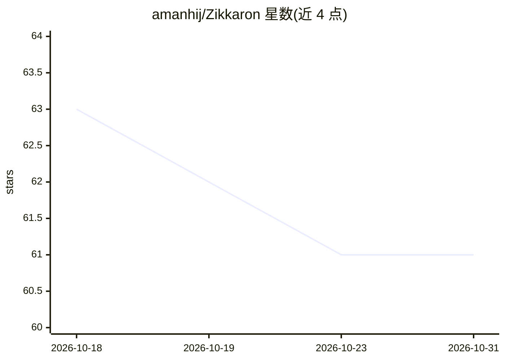

# amanhij/Zikkaron

⭐ 61 · Python · MIT · 推送 2026-04-01 · [GitHub](https://github.com/amanhij/Zikkaron) · [官网](https://zikkaron-frontend.vercel.app) · 个人维护

**给 Claude Code 的本地持久记忆引擎（MCP，SQLite）**

面向 Claude Code 用户（开发者）的持久记忆引擎，以 MCP 服务器形式提供：包含 26 个认知子系统、24 个 MCP 工具，本地运行于单个 SQLite 文件之上。核心机制包括 Hopfield 能量评分、扩散激活、热衰减与再巩固等神经科学启发算法，检索时不调用 LLM、不发起 API 请求，使用 22MB 嵌入模型。支持上下文压缩前后的海马体回放（hook 检查点与上下文重建）、自适应写入门、决策自动保护、项目冷启动种子扫描。需 Python 3.11+。

## 筛选速览

| 维度 | 判定 | 备注 |
|---|---|---|
| AI 角色 | `ai-ecosystem` | LLM/agent 周边工具 |
| 许可风险 | `permissive` | MIT |
| 部署形态 | `library` | 以包/库形式分发 |
| 模型依赖 | locked-api |  |
| 硬件要求 | — | 无带数字的原话,不猜 |
| 安装摩擦 | `low` | 无编译、无系统依赖或容器化 |
| 成熟度 | — | 结构信号不足 |

## 能力要点

- 26 个认知子系统 / 24 个 MCP 工具，本地单 SQLite 文件运行
- 检索路径无 LLM 调用与 API 请求，用 22MB 嵌入模型 + Hopfield 能量评分
- Hippocampal Replay：上下文压缩前后经 hook 保存与重建检查点
- seed_project 一次性扫描项目生成基础记忆（CLI 与 MCP 工具两种方式）

## 适用场景

- 让 Claude Code 跨会话记住项目决策与调试经历
- 长会话中上下文压缩后恢复关键信息
- 在已有大型代码库上快速建立项目记忆（冷启动）

## 场景标签

`Agent 记忆` · 领域:Agent 开发

## 证据(README 行号)

> L12: Zikkaron is a persistent memory engine for Claude Code built on computational neuroscience. It remembers what you w
> L14: 26 subsystems. 24 MCP tools. Runs entirely on your machine. One SQLite file.

## 星数曲线

2026-10-18 63 → 2026-10-31 61（-2）

---
*卡片 v1 · prompt 1.4 · 生成 2026-10-24 · 置信度 high · 依据 README sha `40379fb0e153` · [字段定义](../../DATASET.md)*
