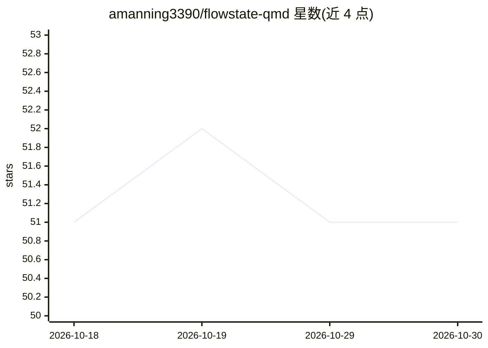

# amanning3390/flowstate-qmd

⭐ 51 · TypeScript · MIT · 推送 2026-03-15 · [GitHub](https://github.com/amanning3390/flowstate-qmd) · 个人维护

**面向编码 agent 的本地先行项目记忆层（MCP）**

Hermes 2026 黑客松作品，基于 QMD：把本地 markdown 知识（文档/ADR/变更日志等）索引为 SQLite+FTS5+sqlite-vec 集合，供 Claude Code、Codex、Cursor 等 MCP 客户端共享；核心机制为 FlowState 预期缓存（intuition.json），监听 agent 会话日志预热上下文，agent 可先调用 fetch_anticipatory_context 再检索。提供 CLI、MCP 服务器、SDK 与打包 agent skill，嵌入与重排用 Qwen3 本地 GGUF 模型（node-llama-cpp），支持 standard/lite 两档硬件配置。限制：仅适用于 markdown 知识，预期记忆依赖活跃会话日志，索引/嵌入为手动操作。

## 筛选速览

| 维度 | 判定 | 备注 |
|---|---|---|
| AI 角色 | `ai-ecosystem` | LLM/agent 周边工具 |
| 许可风险 | `permissive` | MIT |
| 部署形态 | `library` | 以包/库形式分发 |
| 模型依赖 | local-ok | 支持本地模型 |
| 硬件要求 | `gpu-8g` | |
| 安装摩擦 | `low` | 无编译、无系统依赖或容器化 |
| 成熟度 | — | 结构信号不足 |

## 能力要点

- FlowState 预期缓存监听会话日志，先取上下文后检索
- SQLite+FTS5+sqlite-vec 存储，BM25+向量+RRF+重排检索
- 本地 Qwen3 embedding/reranker GGUF 模型，standard/lite 硬件档位
- MCP 服务器 + CLI + SDK + 打包 skill，含 0.90 阈值余弦去重

## 适用场景

- 给编码 agent 接入项目文档与 ADR 的共享记忆
- 让 agent 在提问前即获得相关变更日志/决策记录
- 低内存笔记本或 CI 上用 lite 模式运行本地记忆检索

## 场景标签

`RAG` `Agent 记忆` · 领域:Agent 开发

## 证据(README 行号)

> L5: FlowState-QMD turns local markdown knowledge into shared project memory for Codex-, Claude-, Cursor-, and MCP-style 
> L18: - **MCP-native.** The default experience is a clean MCP server plus a packaged agent skill.
> L125: ### 6. Run as MCP memory for agents

## 星数曲线

2026-10-18 51 → 2026-10-30 51（+0）

---
*卡片 v1 · prompt 1.4 · 生成 2026-10-24 · 置信度 mid · 依据 README sha `fd73c14d480b` · [字段定义](../../DATASET.md)*
