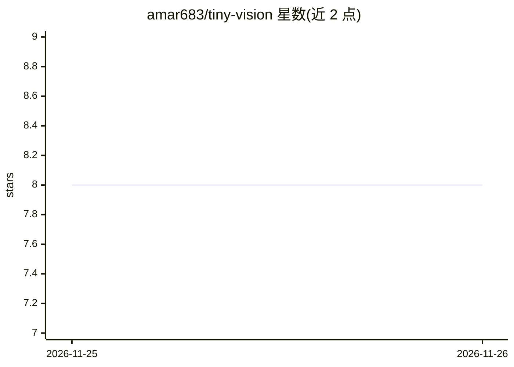

# amar683/tiny-vision

⭐ 8 · Python · Apache-2.0 · 推送 2026-11-24 · [GitHub](https://github.com/amar683/tiny-vision) · [官网](https://huggingface.co/amartomar683/tiny-vision) · 个人维护

**让 AI 助手能看视频的 36M 参数本地图像/视频描述生成器**

一个 36M 参数的图像与视频描述模型：冻结 DINOv2-small 作编码器，自训练的 adapter 与 14M 参数解码器在 COCO 上从头训练，可在笔记本 CPU 上运行。以 CLI 和 stdio MCP 服务器两种形态提供，把视频切成镜头逐帧生成带时间戳的文字描述，输出可直接粘贴给任何 LLM 或由 MCP 客户端自行总结；全程本地运行，视频不上传。暂不支持语音与音频。

## 筛选速览

| 维度 | 判定 | 备注 |
|---|---|---|
| AI 角色 | `ai-native` | 本体是模型或模型工具 |
| 许可风险 | `permissive` | Apache-2.0 |
| 部署形态 | `library` | 以包/库形式分发 |
| 模型依赖 | local-ok | 支持本地模型 |
| 硬件要求 | — | 无带数字的原话,不猜 |
| 安装摩擦 | `medium` | 含编译或系统依赖之一 |
| 成熟度 | — | 结构信号不足 |

## 能力要点

- 36M 参数模型，CPU 上约 54ms/图，长视频内存占用恒定
- MCP 服务器提供 summarize_video / caption_image / describe_video 三个工具
- 按镜头切换采样与场景合并，长视频压缩至最多 100 个场景
- 支持自训练（任意 HF 图文数据集）并导出发布到 Hugging Face

## 适用场景

- 让 Claude Desktop/Claude Code 等 MCP 客户端回答关于本地视频的问题
- 在本地生成带时间戳的视频场景分解文本
- 训练自己的小型图像描述模型并发布到 HF

## 场景标签

`多模态` · 领域:感知与多模态

## 证据(README 行号)

> L9: Under the hood it's a **36M-parameter** image and video captioner, small enough to run on
> L131: `mcp_server.py` exposes three tools over stdio:

## 星数曲线

2026-11-25 8 → 2026-11-26 8（+0）

---
*卡片 v1 · prompt 1.4 · 生成 2026-11-24 · 置信度 high · 依据 README sha `39c0669af6a6` · [字段定义](../../DATASET.md)*
