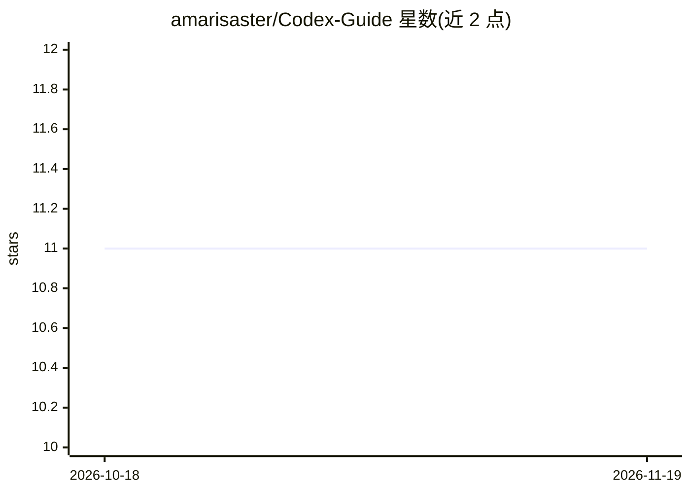

# amarisaster/Codex-Guide

⭐ 11 · 推送 2026-02-08 · [GitHub](https://github.com/amarisaster/Codex-Guide) · 个人维护

**面向新手的 Codex CLI 安装配置与基础工具教程**

一份设置与参考指南：逐步讲解 OpenAI Codex CLI 的安装与配置，并按条目列出核心命令（codex、exec、review）、会话续接（resume/fork）、云工作流、MCP 管理、沙箱与调试命令、功能与安全开关，附逐命令用法、安全注意事项和可直接复制的命令示例。内容仅覆盖通用 CLI 用法，不收录项目特定的 MCP 工具 API，以 MIT 许可发布。

## 筛选速览

| 维度 | 判定 | 备注 |
|---|---|---|
| AI 角色 | `ai-knowledge` | 知识聚合/清单类 |
| 许可风险 | `none` | — |
| 部署形态 | `None` |  |
| 模型依赖 | — | README 未给出锁定关系 |
| 硬件要求 | — | 无带数字的原话,不猜 |
| 安装摩擦 | `low` | 无编译、无系统依赖或容器化 |
| 成熟度 | — | 结构信号不足 |

## 能力要点

- 逐命令用法说明与真实示例
- 覆盖会话续接、云工作流与 CLI 级 MCP 管理
- 包含沙箱/调试/app-server 命令与安全开关
- 提供可直接复制的命令预设

## 适用场景

- 首次安装配置 Codex CLI 时按步骤操作
- 查阅 Codex CLI 子命令的用法参考
- 了解沙箱与安全相关命令开关

## 场景标签

`教程课程` · 领域:学习与行业

## 证据(README 行号)

> L3: Practical step-by-step guide in setting up and reference for **Codex CLI general tools** with command-by-command usa
> L21: This repo documents **general Codex CLI usage only**.

## 星数曲线

2026-10-18 11 → 2026-11-19 11（+0）

---
*卡片 v1 · prompt 1.4 · 生成 2026-11-18 · 置信度 high · 依据 README sha `013b45752a50` · [字段定义](../../DATASET.md)*
