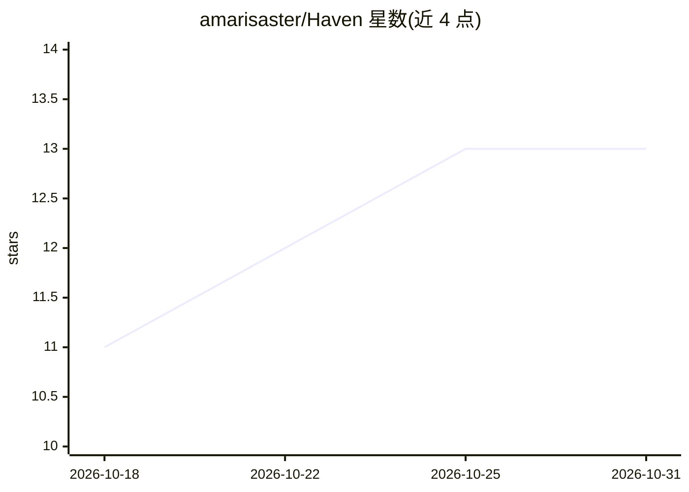

# amarisaster/Haven

⭐ 13 · TypeScript · Apache-2.0 · 推送 2026-10-12 · [GitHub](https://github.com/amarisaster/Haven) · 个人维护

**自托管的 AI 陪伴聊天应用：自带 API key，部署在 Cloudflare 上**

面向个人用户的开源自托管 AI companion 聊天平台：部署到 Cloudflare Workers/Pages（免费层可用），粘贴任意提供商 API key 即可与自定义人格的 AI 伙伴对话。支持单实例最多 10 个 companion，各自独立身份、线程与项目文件；通过 MCP Server 接入外部工具，支持图片视觉、30+ 文件类型读取、DuckDuckGo 联网搜索、多提供商 TTS 与语音输入（Attune 或浏览器 API）。README 明确说明其身份持久化不等于完整记忆系统（无记忆显著性、情感状态跟踪等）。提供 Android APK，配置后端 URL 即可连接。安装需 Node.js v20+ 与 Cloudflare 账号，经 wrangler 部署 worker 与前端。

## 筛选速览

| 维度 | 判定 | 备注 |
|---|---|---|
| AI 角色 | `ai-native` | 本体是模型或模型工具 |
| 许可风险 | `permissive` | Apache-2.0 |
| 部署形态 | `desktop` | 安装包/桌面程序 |
| 模型依赖 | local-ok | 支持本地模型 |
| 硬件要求 | — | 无带数字的原话,不猜 |
| 安装摩擦 | `medium` | 含编译或系统依赖之一 |
| 成熟度 | — | 结构信号不足 |

## 能力要点

- 单实例托管最多 10 个 companion，身份、线程、项目文件相互隔离
- 多提供商接入：OpenRouter、OpenAI、Anthropic、Groq、xAI、Ollama Cloud 等，自动识别 API key
- MCP Server 工具接入（经 Cloudflare Worker /mcp 端点），工具发现后经 function calling 传给模型
- Codex bridge：companion 经本机 Codex CLI 在专用工作区内读写文件，含 diff 卡片与一键回滚

## 适用场景

- 自己部署一个记住我、有固定人格的 AI 陪伴聊天
- 把 SillyTavern / ChatGPT / Claude 的历史对话与角色卡迁移到自托管环境
- 通过 MCP 给 companion 接入 Spotify、Discord、Notion 等工具
- 在手机上用 Android APK 连接自部署的 Haven 后端

## 场景标签

`聊天机器人` · 领域:对话与助手

## 证据(README 行号)

> L15: Haven is a self-hosted companion chat app. You bring the AI model, you bring the personality, and Haven gives them 
> L64: - Chat with your companion using any model — **Ollama Cloud, OpenRouter, OpenAI, Anthropic (native), Groq, xAI**, o
> L44: > **A note on what Haven is:** Haven is a **chat interface with identity persistence** — not a full memory system. 

## 星数曲线

2026-10-18 11 → 2026-10-31 13（+2）

---
*卡片 v1 · prompt 1.4 · 生成 2026-10-31 · 置信度 high · 依据 README sha `de63ad8bf750` · [字段定义](../../DATASET.md)*
