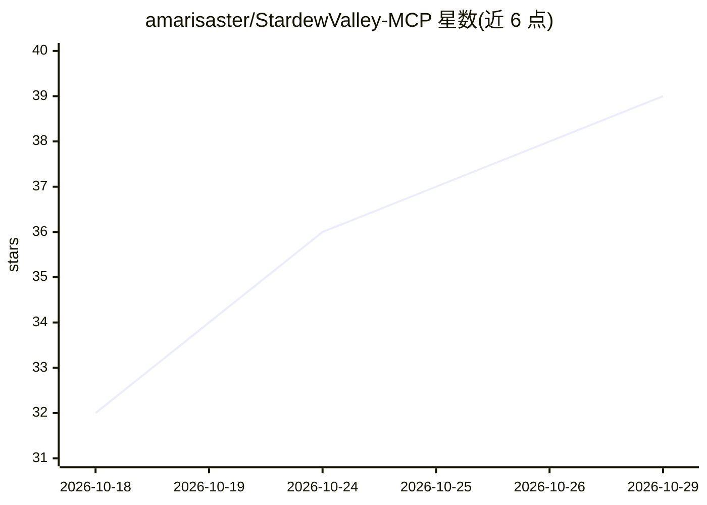

# amarisaster/StardewValley-MCP

⭐ 39 · C# · Apache-2.0 · 推送 2026-06-04 · [GitHub](https://github.com/amarisaster/StardewValley-MCP) · 个人维护

**让 AI 陪伴角色通过 MCP 操作星露谷物语的模组+服务端**

由两部分组成：SMAPI 模组（C#/.NET，运行在游戏内）与 Node.js MCP Server，通过 JSON 文件桥接。模组以可见 NPC 加隐形 shadow farmer 生成 AI 陪伴角色，由 MCP 工具调用直接控制，或进入 follow/farm/mine/fish 自主模式。MCP Server 经 stdio 暴露 25 个工具（13 全局 + 12 玩家模式），供 Claude 等 AI agent 调用。需自行 dotnet build 与 npm build，要求游戏 1.6+、SMAPI 4.0+、Node 18+。

## 筛选速览

| 维度 | 判定 | 备注 |
|---|---|---|
| AI 角色 | `ai-ecosystem` | LLM/agent 周边工具 |
| 许可风险 | `permissive` | Apache-2.0 |
| 部署形态 | `library` | 以包/库形式分发 |
| 模型依赖 | — | README 未给出锁定关系 |
| 硬件要求 | — | 无带数字的原话,不猜 |
| 安装摩擦 | `medium` | 含编译或系统依赖之一 |
| 成熟度 | — | 结构信号不足 |

## 能力要点

- AI 陪伴角色以 Player 2/3 身份加入，含自定义立绘贴图
- MCP Server 提供 25 个工具（13 全局模式 + 12 直接控制）
- follow/farm/mine/fish 等自主行为模式
- shadow farmer 机制处理工具、战斗、钓鱼等实际游戏逻辑

## 适用场景

- 让 Claude 等 MCP 客户端作为 AI 队友一起玩星露谷
- 让 AI 陪伴角色自动种田、挖矿、钓鱼
- 作为游戏内 AI agent 实验的 MCP 测试环境

## 场景标签

 · 领域:游戏/AI工具

## 证据(README 行号)

> L3: AI companions for Stardew Valley, controlled through the Model Context Protocol. Spawn companions as **Player 2/3** 
> L20: **MCP Server** (`mcp-server/`): Exposes 25 tools over stdio transport. 13 global tools for mode-based control + 12 

## 星数曲线

2026-10-18 32 → 2026-10-29 39（+7）

---
*卡片 v1 · prompt 1.4 · 生成 2026-10-25 · 置信度 high · 依据 README sha `52e50f25305d` · [字段定义](../../DATASET.md)*
