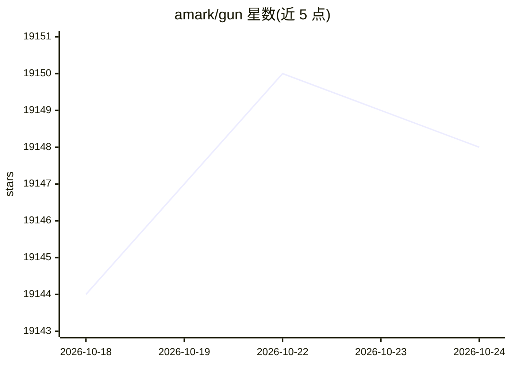

# amark/gun

⭐ 19,149 · JavaScript · NOASSERTION · 推送 2026-10-15 · [GitHub](https://github.com/amark/gun) · [官网](https://gun.eco/docs) · 个人维护

**去中心化图数据同步协议，供开发者构建 P2P 加密应用**

GUN 是一个图数据同步协议及配套工具生态，提供端到端加密的实时 P2P 状态同步，支持键值、表、文档等多种数据形态的图存储，本地优先、可离线运行。由 Mark Nadal 于 2014 年创建，核心引擎压缩后约 9KB。以 npm 包分发，可在浏览器通过 CDN 脚本引入，也提供 Docker 镜像、Linux 安装脚本、Heroku 等多种 relay 部署途径。框架适配方面给出 React、Vue、Svelte、Electron 等文档入口。

## 筛选速览

| 维度 | 判定 | 备注 |
|---|---|---|
| AI 角色 | `ai-ecosystem` | LLM/agent 周边工具 |
| 许可风险 | `none` | NOASSERTION |
| 部署形态 | `self-host` | docker 或自建部署 |
| 模型依赖 | — | README 未给出锁定关系 |
| 硬件要求 | — | 无带数字的原话,不猜 |
| 安装摩擦 | `low` | 无编译、无系统依赖或容器化 |
| 成熟度 | — | 结构信号不足 |

## 动量与使用信号

- 维护:`active` — 距上次 push 3.3 天,年发版 0,144 位贡献者
- 涨星:近 1 天 **+2**(自 20261016 起算)
- 安装:npm 包 `gun` 月下载 243,306
- 平台:WEB · 协议:—

## 能力要点

- 实时 P2P 状态同步，本地优先、可离线、端到端加密
- 图数据模型兼容键值/表/文档等多种访问方式
- 约 9KB gzipped 的嵌入式引擎，含 CRDT 冲突解决与加密模块
- 提供 npm 包、浏览器 CDN、Docker 镜像等多种接入与部署方式

## 适用场景

- 为多人协作应用做实时 P2P 数据同步
- 构建无中心服务器的社区应用
- 离线优先应用中跨设备同步数据
- 为开发团队部署去中心化 relay 节点

## 场景标签

 · 领域:去中心化数据库/数据同步

## 证据(README 行号)

> L4: **GUN** is an ecosystem of **tools** that let you build community run and encrypted applications - like an Open Sour
> L63: Technically, **GUN is a graph synchronization protocol** with a *lightweight embedded engine*, capable of doing *20
> L122: To quickly spin up a GUN relay peer for your development team, utilize Heroku, Docker, or any others listed below.

## 星数曲线

2026-10-18 19,144 → 2026-10-24 19,148（+4）

---
*卡片 v1 · prompt 1.4 · 生成 2026-10-18 · 置信度 high · 依据 README sha `cd23063b9ffa` · [字段定义](../../DATASET.md)*
