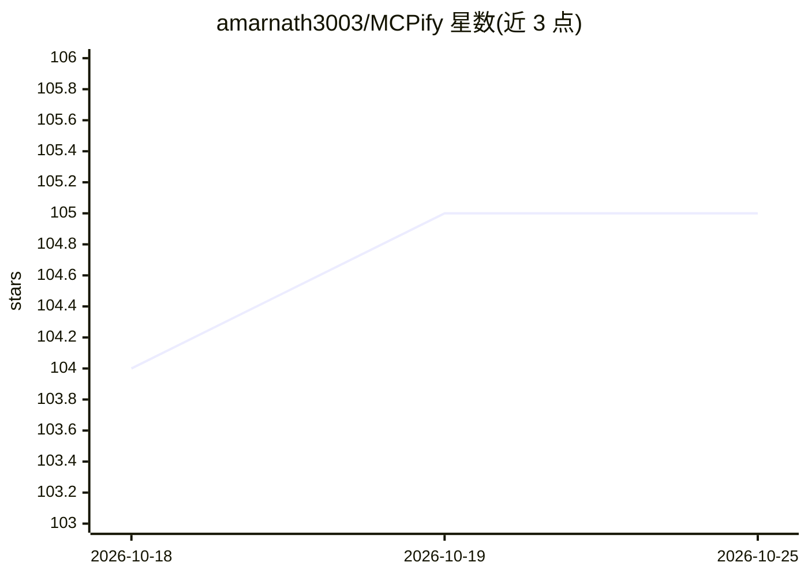

# amarnath3003/MCPify

⭐ 105 · TypeScript · NOASSERTION · 推送 2026-07-01 · [GitHub](https://github.com/amarnath3003/MCPify) · [官网](https://mcpify.vercel.app) · 个人维护

**把现有应用编译成 MCP 服务器的 AI 接入编译器**

面向开发者的 CLI 工具：通过 AST 分析扫描现有代码库的后端路由、前端组件、OpenAPI/Prisma/Drizzle/Mongoose schema 与 webhook，生成可运行的 MCP 服务器、语义化工作流、带权限作用域与审计日志的工具集，以及 agent 可读的元数据，使 autonomous agent 能直接操作该应用；每次提交自动重新生成以保持同步。以 npx 直接运行或源码构建，支持注册到 Codex、Claude Code/Desktop、VSCode 等客户端；AI 描述增强与模拟功能需设置 ANTHROPIC_API_KEY。

## 筛选速览

| 维度 | 判定 | 备注 |
|---|---|---|
| AI 角色 | `ai-ecosystem` | LLM/agent 周边工具 |
| 许可风险 | `none` | NOASSERTION |
| 部署形态 | `library` | 以包/库形式分发 |
| 模型依赖 | — | README 未给出锁定关系 |
| 硬件要求 | — | 无带数字的原话,不猜 |
| 安装摩擦 | `low` | 无编译、无系统依赖或容器化 |
| 成熟度 | — | 结构信号不足 |

## 能力要点

- 后端 AST 分析支持 Express/Fastify/NestJS/Next.js，含非导出内联处理器
- OpenAPI/Swagger 规格直接转换为带类型的 MCP 工具
- 权限层在工具边界强制作用域、角色与审计日志
- 提交时自动重新生成 MCP 定义，支持 --watch

## 适用场景

- 为已有 Node.js 后端生成 MCP 服务器，避免手写工具样板
- 把 OpenAPI 规格快速转成 agent 可调用的工具面
- 上线前用 audit/simulate 命令对生成的工具面做静态安全审计与 AI 沙箱模拟

## 场景标签

 · 领域:AI Agent 基础设施/MCP 工具链

## 证据(README 行号)

> L50: MCPify acts as a compiler for your application. It scans the parts of the codebase that matter to agents and produc
> L189: 1. **AI Agents:** Any agent runtime (Claude, GPT, Custom) connects over MCP to start operating your software like 

## 星数曲线

2026-10-18 104 → 2026-10-25 105（+1）

---
*卡片 v1 · prompt 1.4 · 生成 2026-10-23 · 置信度 high · 依据 README sha `038e0f32bf67` · [字段定义](../../DATASET.md)*
