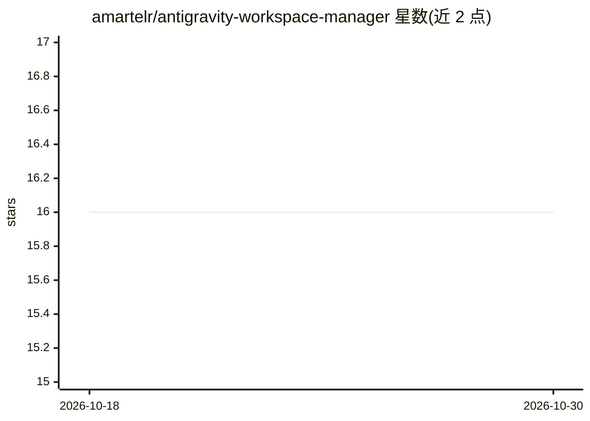

# amartelr/antigravity-workspace-manager

⭐ 16 · Python · MIT · 推送 2026-02-28 · [GitHub](https://github.com/amartelr/antigravity-workspace-manager) · 个人维护

**为 AI 编码 agent 按项目编排与注入 skills 上下文的 CLI**

围绕 antigravity-awesome-skills 技能库（250+ skills）的编排管理 CLI：以 workspace 为单位为每个项目维护独立的 skill-config.json 与 symlink 环境，仅向 AI 助手（Antigravity、Claude Code、Cursor）注入所需技能上下文。提供向导式建区（项目类型/语言/数据库选择后推荐技能）、技能启用/禁用/目录查看、从官方仓库同步与自动修复孤儿技能、bundle 模板脚手架、crontab 定时同步等命令。通过 install.sh 一键安装获得 wsm 命令，或 git clone 手动初始化。README 提供英语与西班牙语版本。

## 筛选速览

| 维度 | 判定 | 备注 |
|---|---|---|
| AI 角色 | `ai-ecosystem` | LLM/agent 周边工具 |
| 许可风险 | `permissive` | MIT |
| 部署形态 | `None` |  |
| 模型依赖 | — | README 未给出锁定关系 |
| 硬件要求 | — | 无带数字的原话,不猜 |
| 安装摩擦 | `low` | 无编译、无系统依赖或容器化 |
| 成熟度 | — | 结构信号不足 |

## 能力要点

- 每个 workspace 独立 skill-config.json 与 symlink 环境隔离
- 5 步向导按技术栈（14 种项目类型/15 种语言/11 种数据库）推荐技能
- wsm sync --auto-fix 同步官方仓库并清理孤儿/损坏技能
- frontend/backend/mobile bundle 模板批量注入技能

## 适用场景

- 为 Claude Code/Cursor 等 AI 编码助手按项目加载精准技能上下文
- 多项目管理技能启用状态并定期同步更新
- 用向导快速为新项目搭配合适的技能组合

## 场景标签

`提示工程` · 领域:Agent 开发

## 证据(README 行号)

> L10: A complete management system to structure your projects (workspaces) and dynamically inject *skills* using the famo
> L124: Collect the described skills logic reading from the local context path ./skill-config.json

## 星数曲线

2026-10-18 16 → 2026-10-30 16（+0）

---
*卡片 v1 · prompt 1.4 · 生成 2026-10-30 · 置信度 high · 依据 README sha `ad3ec1aebc1e` · [字段定义](../../DATASET.md)*
