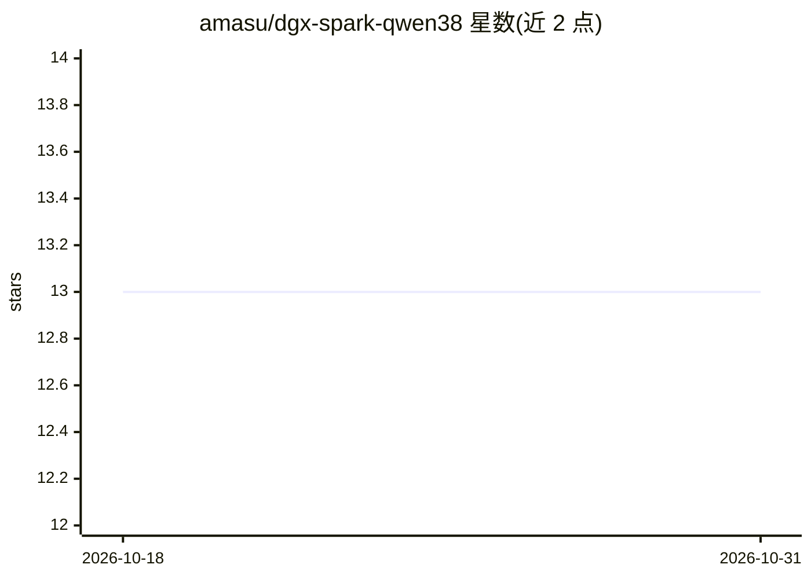

# amasu/dgx-spark-qwen38

⭐ 13 · Shell · MIT · 推送 2026-10-27 · [GitHub](https://github.com/amasu/dgx-spark-qwen38) · 个人维护

**在 DGX Spark (GB10) 上用 Docker Compose 部署 Qwen3.8-27B 的推理服务配置集**

面向 NVIDIA DGX Spark (GB10) 设备的 Docker Compose 配置集合，用于部署 Qwen3.8-27B 模型推理服务。当前生产栈为 SGLang + NVFP4 量化 + DFlash2 块扩散投机解码（greedy 默认采样，262144 tokens 上下文，端口 8000 暴露 OpenAI 兼容端点）；另保留 vLLM+MTP、SGLang+DSpark、FP8 legacy 三套回滚栈。所有路径、端口、模型 id 通过环境变量参数化，无需主机专属配置。镜像 qwen38-dflash2:v1.2.2 不发布到 registry，需每台主机本地构建；附 bench-matrix.sh 基准脚本与 benchmarking.md A/B 实验记录。限制：DFlash2 不兼容 YaRN 上下文扩展；mem-fraction-static 需保持 0.50。

## 筛选速览

| 维度 | 判定 | 备注 |
|---|---|---|
| AI 角色 | `ai-ecosystem` | LLM/agent 周边工具 |
| 许可风险 | `permissive` | MIT |
| 部署形态 | `self-host` | docker 或自建部署 |
| 模型依赖 | local-ok | 支持本地模型 |
| 硬件要求 | — | 无带数字的原话,不猜 |
| 安装摩擦 | `low` | 无编译、无系统依赖或容器化 |
| 成熟度 | — | 结构信号不足 |

## 能力要点

- 当前生产栈 SGLang + NVFP4 + DFlash2 投机解码，262144 tokens 上下文
- 三套备用回滚栈（vLLM+MTP、SGLang+DSpark、FP8 legacy）可即时切换
- 全栈环境变量参数化，clean clone 约 7 分钟完成生产重部署
- 附 bench-matrix.sh 跨引擎基准脚本与 tool-eval A/B 实验记录

## 适用场景

- 在 DGX Spark 上部署 OpenAI 兼容的 Qwen3.8-27B 推理端点
- 在不同推理引擎/量化方案间做 A/B 对比与回滚
- 对 GB10 上的 LLM 服务做可复现的吞吐基准测试

## 场景标签

`推理引擎` `模型量化` · 领域:训练与推理

## 证据(README 行号)

> L3: Compose configs for serving **Qwen3.8-27B** on an NVIDIA DGX Spark (GB10) unit.
> L102: Only one stack runs at a time; switch with `docker compose -f <file> up -d`
> L103: after `docker compose down`. All stacks expose the OpenAI-compatible endpoint

## 星数曲线

2026-10-18 13 → 2026-10-31 13（+0）

---
*卡片 v1 · prompt 1.4 · 生成 2026-10-31 · 置信度 high · 依据 README sha `18dd93511d79` · [字段定义](../../DATASET.md)*
