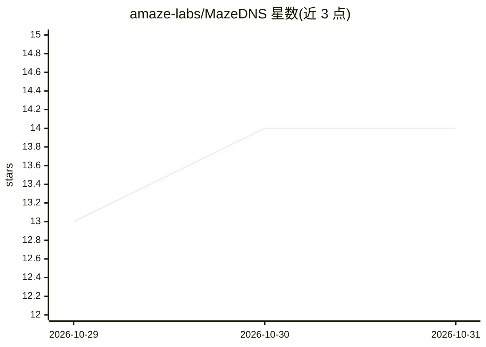

# amaze-labs/MazeDNS

⭐ 14 · Go · AGPL-3.0 · 推送 2026-10-26 · [GitHub](https://github.com/amaze-labs/MazeDNS) · 组织维护

**多站点自托管 DNS 过滤解析器，可选 AI 域名分类**

自托管 DNS 过滤解析器，由一个控制平面（Web UI/API）与任意数量 DNS agent 容器组成，agent 自动同步配置并在客户端就近应答，控制平面宕机时 agent 仍可继续解析。功能包括广告/分类拦截（URL/文件/自定义规则）、新域名流量类型标注与 0-100 合法性评分（可选远程 LLM 与威胁源/WHOIS 信号，默认不外发数据）、本地记录与条件转发、DoT/DoH、DNSSEC、OIDC 单点登录、Prometheus 指标。以 Docker Compose/Kubernetes 部署。安全注意事项包括解析器无客户端 ACL、速率限制默认关闭。

## 筛选速览

| 维度 | 判定 | 备注 |
|---|---|---|
| AI 角色 | `ai-enhanced` | 去掉 AI 部分产品仍成立 |
| 许可风险 | `viral` | AGPL-3.0 |
| 部署形态 | `self-host` | docker 或自建部署 |
| 模型依赖 | — | README 未给出锁定关系 |
| 硬件要求 | — | 无带数字的原话,不猜 |
| 安装摩擦 | `low` | 无编译、无系统依赖或容器化 |
| 成熟度 | — | 结构信号不足 |

## 能力要点

- 单控制平面驱动多站点 DNS agent，agent 离线仍继续解析
- 新域名流量分类与 0-100 合法性评分，AI 模型为可选组件且默认不外发数据
- DoT/DoH 双向支持、DNSSEC 透明转发、按客户端限速
- 提供本地用户或任意 OIDC 提供商单点登录

## 适用场景

- 跨多个家庭或办公站点统一管理广告与内容过滤
- 审查新出现域名的风险并自动或手动拦截
- 运维内部域名与按站点拆分（split-horizon）解析

## 场景标签

 · 领域:网络基础设施/DNS 安全

## 证据(README 行号)

> L6: A self-hosted **DNS filtering resolver**, like AdGuard Home or Pi-hole, built for
> L39:  common platforms, and optionally an AI model.
> L42:  the name, an optional AI model). Risky ones wait for your review or are

## 星数曲线

2026-10-29 13 → 2026-10-31 14（+1）

---
*卡片 v1 · prompt 1.4 · 生成 2026-10-31 · 置信度 high · 依据 README sha `129ffc76cc69` · [字段定义](../../DATASET.md)*
