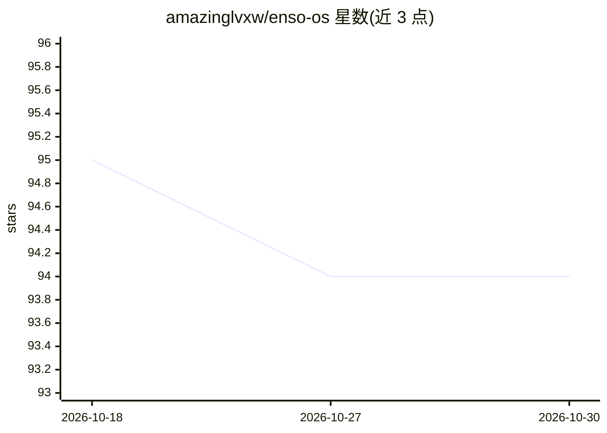

# amazinglvxw/enso-os

⭐ 94 · Shell · MIT · 推送 2026-04-24 · [GitHub](https://github.com/amazinglvxw/enso-os) · [官网](https://github.com/amazinglvxw/enso-os/releases/tag/v0.7.0) · 个人维护 · 中文 README

**给 AI agent 加纪律层的插件：错误学习、主动遗忘、主动问责挑战**

以 bash+python3 实现的 agent 插件，包裹 Claude Code、Gemini CLI、Hermes、OpenClaw 等现有 agent 运行：12 个 shell hooks 分 5 层，代码强制执行错误捕获与教训蒸馏、会话启动注入、过期知识衰减/LRU 清除、不可变自保护 hook、密钥注入扫描与记忆预算守卫；其中 pre-tool-use 守卫层仅 Claude Code 与 Gemini CLI 支持。v0.7 新增 PAC 机制：扫描会话日志与决策模式，检测 5 类自我设限行为并在下个会话注入苏格拉底式挑战，带 1/日、3/周等防疲劳硬限制与约束型/自限型分类，不确定时保持沉默。数据 100% 本地存储于 ~/.enso/。

## 筛选速览

| 维度 | 判定 | 备注 |
|---|---|---|
| AI 角色 | `ai-ecosystem` | LLM/agent 周边工具 |
| 许可风险 | `permissive` | MIT |
| 部署形态 | `library` | 以包/库形式分发 |
| 模型依赖 | — | README 未给出锁定关系 |
| 硬件要求 | — | 无带数字的原话,不猜 |
| 安装摩擦 | `low` | 无编译、无系统依赖或容器化 |
| 成熟度 | — | 结构信号不足 |

## 能力要点

- 12 hooks/5 层架构：错误→教训→下会话注入的代码级强制学习环
- 主动遗忘：37 天未用删除、超 50 条 LRU 逐出、追踪 14 天轮换
- PAC 主动问责挑战：检测 5 类自我设限模式，含防疲劳硬限制与 PAC_ENABLED=false 开关
- 不可变自保护：agent 无法修改自身 hooks，附每周 enso-lint.sh 知识库体检

## 适用场景

- 让 Claude Code/Gemini CLI 等 agent 自动从错误中学习并避免重复犯错
- 为 agent 记忆系统加过期衰减与质量检查
- 通过 PAC 在会话开始时收到对未察觉行为模式的问责提问

## 场景标签

`Agent 记忆` · 领域:Agent 开发

## 证据(README 行号)

> L26: Install in 30 seconds. Just bash + python3 (pre-installed on macOS/Linux). Wraps around Claude Code, Hermes, OpenCl
> L122: |What Enso adds|What your host agent handles|
> L135: Enso doesn't replace your agent. It makes it more disciplined. Like SELinux for your AI — invisible when things go

## 星数曲线

2026-10-18 95 → 2026-10-30 94（-1）

---
*卡片 v1 · prompt 1.4 · 生成 2026-10-23 · 置信度 mid · 依据 README sha `07f81aae2e75` · [字段定义](../../DATASET.md)*
