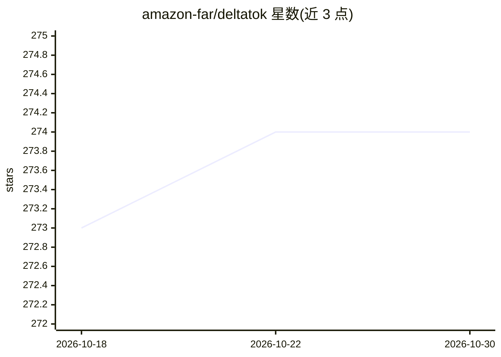

# amazon-far/deltatok

⭐ 274 · Python · Apache-2.0 · 推送 2026-07-17 · [GitHub](https://github.com/amazon-far/deltatok) · [官网](https://deltatok.github.io) · 组织维护

**CVPR 2026 论文官方实现：帧间差分 token 化与世界模型预测**

论文 'A Frame is Worth One Token' 的 PyTorch 官方实现。DeltaTok 将视觉基础模型（冻结 DINOv3 ViT-B）特征的帧间变化压缩为单个 delta token，DeltaWorld 基于此生成多样化未来帧特征；提供在 Kinetics-700 训练的 tokenizer 与 predictor 预训练权重，以及 VSPW/Cityscapes/KITTI 下游任务头。训练需 Miniconda、W&B 与 Hugging Face 账号，有效 batch size 1024，默认 8 GPU 配置，示例训练在 NVIDIA H200 上测量（最大 109 GB 显存）。Apache-2.0 许可。

## 筛选速览

| 维度 | 判定 | 备注 |
|---|---|---|
| AI 角色 | `ai-native` | 本体是模型或模型工具 |
| 许可风险 | `permissive` | Apache-2.0 |
| 部署形态 | `desktop` | 安装包/桌面程序 |
| 模型依赖 | — | README 未给出锁定关系 |
| 硬件要求 | — | 无带数字的原话,不猜 |
| 安装摩擦 | `low` | 无编译、无系统依赖或容器化 |
| 成熟度 | — | 结构信号不足 |

## 能力要点

- DeltaTok 将帧间特征变化压缩为单个 delta token
- DeltaWorld 基于 delta token 生成未来帧特征
- 提供 tokenizer/predictor 预训练权重与分割/深度任务头
- 两阶段训练（256px 预训练 + 512px 微调）与 LR cooldown 流程

## 适用场景

- 复现论文的训练与评估结果
- 在 VSPW/Cityscapes/KITTI 上评估特征重构与预测质量
- 研究生成式世界建模与视频特征 token 化方法

## 场景标签

`模型训练` · 领域:训练与推理

## 证据(README 行号)

> L5: Models
> L11: All models operate at 512x512 resolution with a frozen DINOv3 ViT-B backbone. The released DeltaTok and DeltaWorld 

## 星数曲线

2026-10-18 273 → 2026-10-30 274（+1）

---
*卡片 v1 · prompt 1.4 · 生成 2026-10-22 · 置信度 mid · 依据 README sha `d52ef0466714` · [字段定义](../../DATASET.md)*
