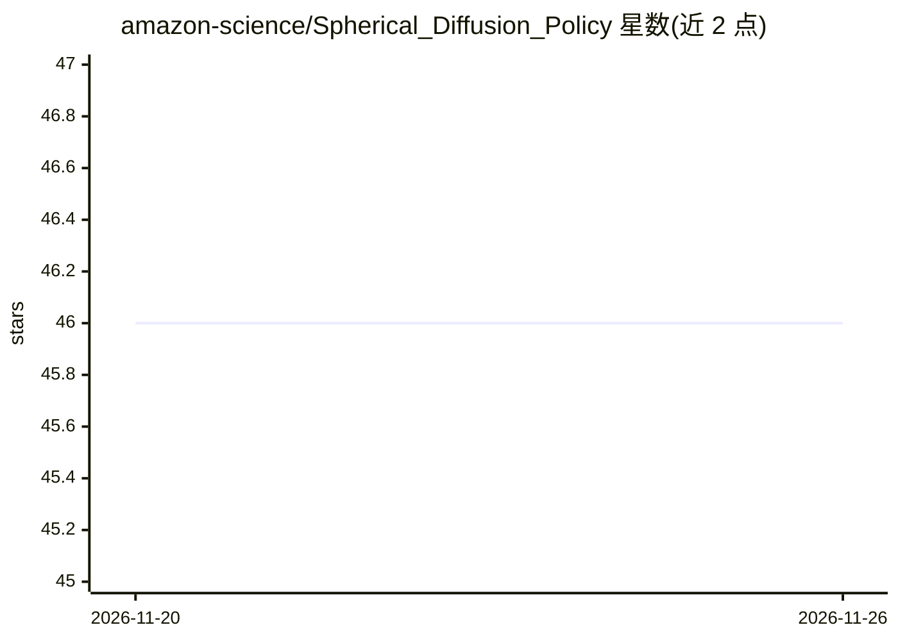

# amazon-science/Spherical_Diffusion_Policy

⭐ 46 · Python · MIT · 推送 2026-11-19 · [GitHub](https://github.com/amazon-science/Spherical_Diffusion_Policy) · 组织维护

**科研用 SE(3) 等变机器人操作视觉运动策略的训练实现**

ICML 2025 论文 Spherical Diffusion Policy 的官方实现：一个基于球面傅里叶表示的 SE(3) 等变、T(3) 不变视觉运动策略，由球面傅里叶表征、Spherical FiLM 条件化与球面去噪 UNet（SDTU）三个组件构成。仓库提供 MimicGen 20 个仿真任务与 5 个真实单/双臂机器人任务的训练与评估脚本、数据集下载与预处理工具。安装需 conda/mamba 环境、mujoco 等 apt 包，训练默认需约 22G 显存，支持 accelerate 多卡训练。

## 筛选速览

| 维度 | 判定 | 备注 |
|---|---|---|
| AI 角色 | `ai-native` | 本体是模型或模型工具 |
| 许可风险 | `permissive` | MIT |
| 部署形态 | `library` | 以包/库形式分发 |
| 模型依赖 | — | README 未给出锁定关系 |
| 硬件要求 | `gpu-8g` | |
| 安装摩擦 | `medium` | 含编译或系统依赖之一 |
| 成熟度 | — | 结构信号不足 |

## 能力要点

- 球面傅里叶表征编码机器人状态与动作，具连续旋转等变性
- 提供 MimicGen 仿真基准与真实机器人任务的训练/评估脚本
- 含数据集下载、点云/体素观测生成与动作空间转换工具
- 支持 accelerate 多 GPU 训练与 osmesa 无头渲染模式

## 适用场景

- 在 MimicGen SE(3) 随机化任务上复现论文实验
- 训练机器人单臂/双臂操作的视觉运动策略
- 作为等变扩散策略研究的基线代码基础

## 场景标签

`科研工具` `模型训练` · 领域:学习与行业

## 证据(README 行号)

> L6: Official implementation for **Spherical Diffusion Policy: A SE(3) Equivariant Visuomotor Policy with Spherical Fouri
> L10: Spherical Diffusion Policy (SDP) is a SE(3) equivariant and T(3) invariant visuomotor policy that leverages spheric

## 星数曲线

2026-11-20 46 → 2026-11-26 46（+0）

---
*卡片 v1 · prompt 1.4 · 生成 2026-11-20 · 置信度 high · 依据 README sha `fc511b485d2c` · [字段定义](../../DATASET.md)*
