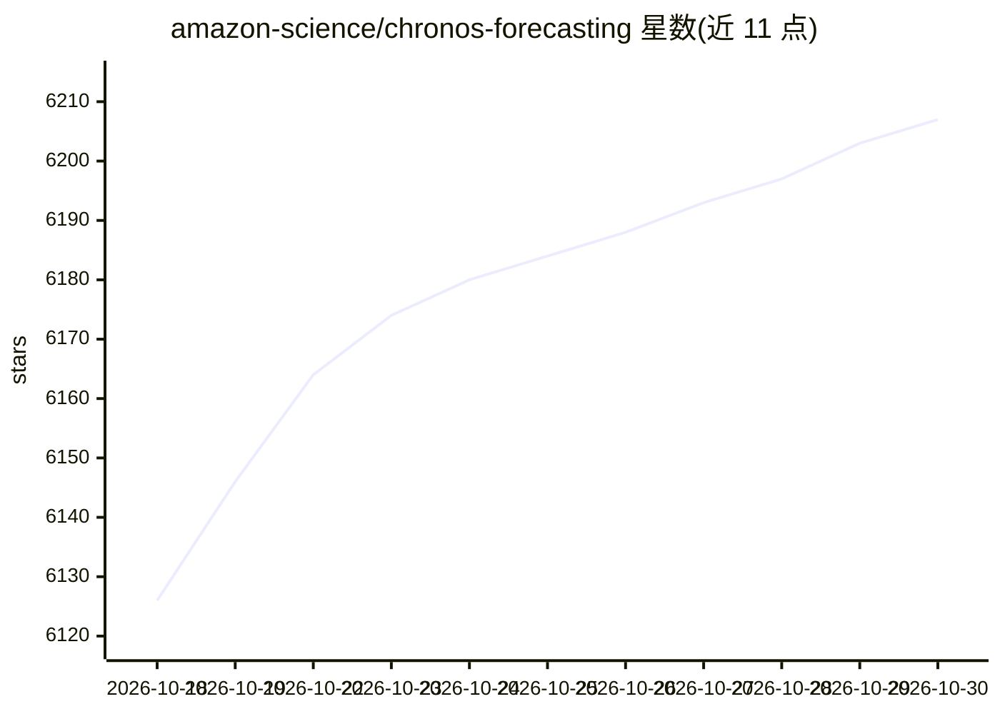

# amazon-science/chronos-forecasting

⭐ 6,207 · Python · Apache-2.0 · 推送 2026-10-05 · [GitHub](https://github.com/amazon-science/chronos-forecasting) · [官网](https://arxiv.org/abs/2510.15821) · 组织维护

**预训练时间序列预测模型库：零样本单变量/多变量预测**

提供 Chronos 系列预训练时间序列预测模型的推理接口：Chronos-2 支持单变量、多变量与含协变量的零样本预测；Chronos-Bolt 采用基于 patch 的编码器与直接多步分位数预测；初代 Chronos 将时间序列经缩放与量化转为 token，用语言模型架构训练并以采样生成概率预测。以 pip 安装的 Python 包形式提供，模型托管于 Hugging Face，含快速上手 notebook，并给出 SageMaker JumpStart 与 AutoGluon-Cloud 两种 AWS 部署途径。供需要开箱即用预测能力的时间序列分析与机器学习开发者使用。

## 筛选速览

| 维度 | 判定 | 备注 |
|---|---|---|
| AI 角色 | `ai-native` | 本体是模型或模型工具 |
| 许可风险 | `permissive` | Apache-2.0 |
| 部署形态 | `library` | 以包/库形式分发 |
| 模型依赖 | — | README 未给出锁定关系 |
| 硬件要求 | — | 无带数字的原话,不猜 |
| 安装摩擦 | `low` | 无编译、无系统依赖或容器化 |
| 成熟度 | — | 结构信号不足 |

## 能力要点

- Chronos-2 零样本支持单变量/多变量/协变量预测任务
- 12 个模型变体（9M–710M 参数）托管于 Hugging Face
- Chronos-Bolt 采用 patch 化编码与直接多步分位数预测
- 提供 AWS SageMaker JumpStart / AutoGluon-Cloud 部署教程与示例 notebook

## 适用场景

- 在没有训练数据的情况下做零样本时间序列预测
- 为包含外生特征的预测任务生成概率预测
- 将预训练预测模型部署到 AWS 做实时或批量推理

## 场景标签

 · 领域:时间序列预测/机器学习

## 证据(README 行号)

> L22: This package provides an interface to the Chronos family of **pretrained time series forecasting models**. The foll
> L26: - **Chronos**: The original Chronos family which is based on language model architectures. A time series is transfo

## 星数曲线

2026-10-18 6,126 → 2026-10-30 6,207（+81）

---
*卡片 v1 · prompt 1.4 · 生成 2026-10-21 · 置信度 high · 依据 README sha `5fb220bee3f8` · [字段定义](../../DATASET.md)*
