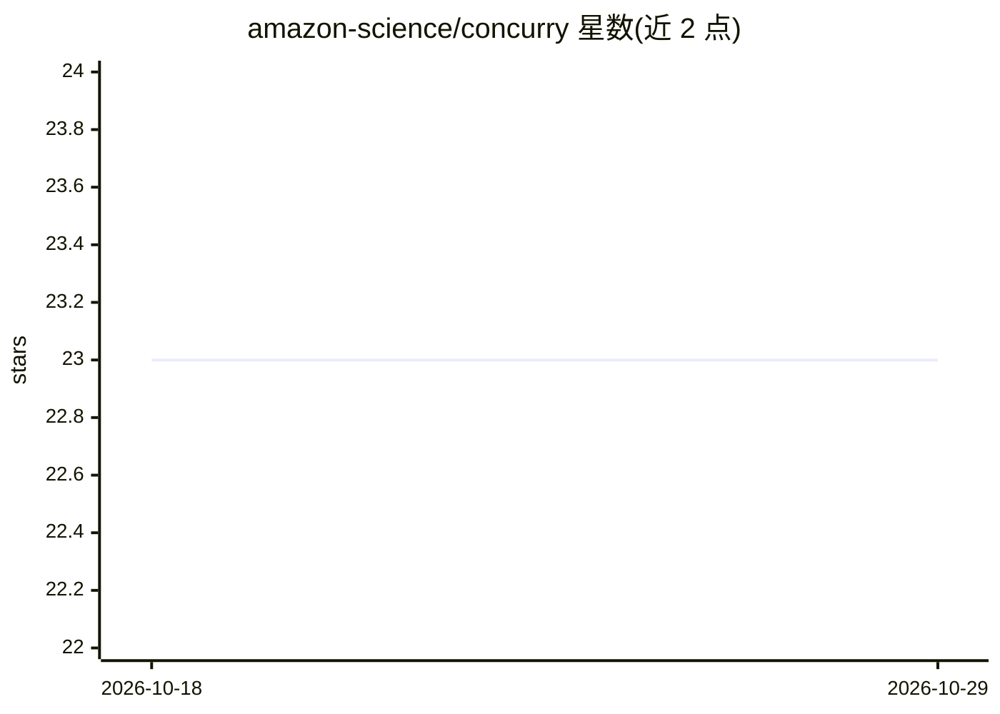

# amazon-science/concurry

⭐ 23 · Python · Apache-2.0 · 推送 2026-06-13 · [GitHub](https://github.com/amazon-science/concurry) · [官网](https://amazon-science.github.io/concurry/) · 组织维护

**面向 AI 实验的 Python 并发库：3 行代码扩展到多核/多节点**

统一 API 的 Python 并发库，将 threading、multiprocessing、asyncio、Ray 的能力抽象为单一接口，同一份业务代码可在单线程、多核或分布式集群上运行。面向需要并行化 AI 实验与 LLM 批量调用的开发者。核心机制包括带状态的 Actor 式 worker、全局限流（令牌桶/滑动窗口）、声明式重试与 Pydantic 参数校验；分布式支持通过可选 extras "concurry[ray]" 提供，Apache 2.0 许可，由 Amazon 科学家维护。

## 筛选速览

| 维度 | 判定 | 备注 |
|---|---|---|
| AI 角色 | `ai-ecosystem` | LLM/agent 周边工具 |
| 许可风险 | `permissive` | Apache-2.0 |
| 部署形态 | `library` | 以包/库形式分发 |
| 模型依赖 | — | README 未给出锁定关系 |
| 硬件要求 | — | 无带数字的原话,不猜 |
| 安装摩擦 | `low` | 无编译、无系统依赖或容器化 |
| 成熟度 | — | 结构信号不足 |

## 能力要点

- 统一 API 覆盖线程/多进程/asyncio/Ray 后端，代码无需改写即可换后端
- Actor 式有状态 worker，可持有数据库连接、模型权重等资源
- 内置全局限流与声明式重试配置
- Pydantic 集成：参数在进入 worker 前完成校验与转换

## 适用场景

- 把串行的 LLM 批量调用改成并行执行以缩短耗时
- 同一份代码在笔记本单机与多节点集群间切换运行
- 给批量 API 调用加限流与自动重试

## 场景标签

 · 领域:分布式计算/LLM 工具链

## 证据(README 行号)

> L13: Concurry is a unified, delightful concurrency library for Python. It replaces the fragmented landscape of `threadin
> L17: Calling LLMs sequentially is painfully slow. With Concurry, you can parallelize your existing code instantly.

## 星数曲线

2026-10-18 23 → 2026-10-29 23（+0）

---
*卡片 v1 · prompt 1.4 · 生成 2026-10-27 · 置信度 high · 依据 README sha `81f3bea66fb3` · [字段定义](../../DATASET.md)*
