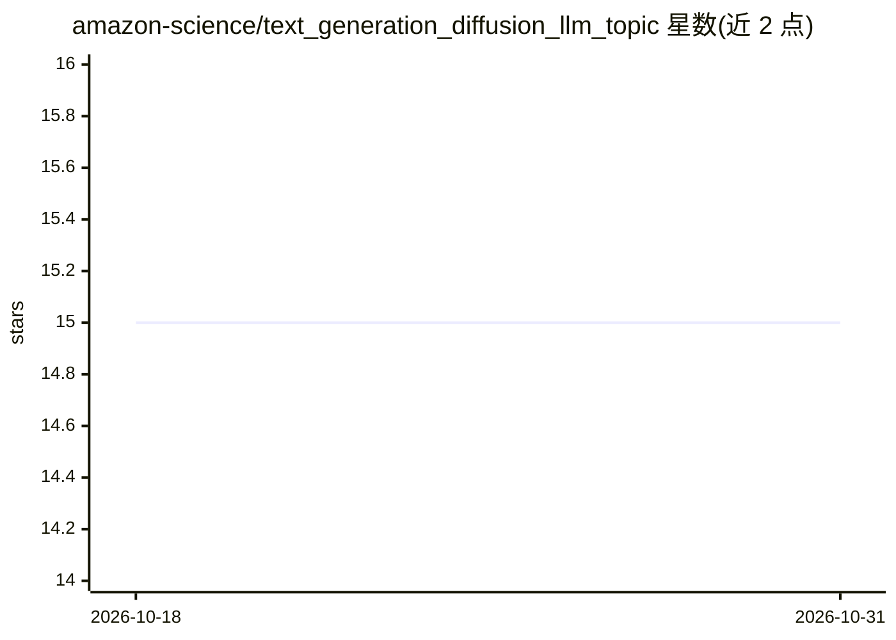

# amazon-science/text_generation_diffusion_llm_topic

⭐ 15 · Python · Apache-2.0 · 推送 2026-10-29 · [GitHub](https://github.com/amazon-science/text_generation_diffusion_llm_topic) · 组织维护

**EMNLP 2023 论文 DeTiME 官方实现：扩散增强的主题建模与文本生成**

amazon-science 发布的 DeTiME（Accepted by EMNLP 2023 Findings）官方代码库：基于 encoder-decoder 结构的 LLM（涉及 T5、主题嵌入）生成文本嵌入，用扩散模型对嵌入去噪，再经解码器生成文本，支持主题建模训练与评估（diversity、c_v、c_uci 等指标）。数据源支持 Hugging Face 仓库、csv、txt；提供训练、扩散模型训练与文本生成的脚本和示例代码。README 说明本次发布使用已有嵌入而非球形嵌入，报告性能优于论文中数值。

## 筛选速览

| 维度 | 判定 | 备注 |
|---|---|---|
| AI 角色 | `ai-native` | 本体是模型或模型工具 |
| 许可风险 | `permissive` | Apache-2.0 |
| 部署形态 | `library` | 以包/库形式分发 |
| 模型依赖 | — | README 未给出锁定关系 |
| 硬件要求 | — | 无带数字的原话,不猜 |
| 安装摩擦 | `low` | 无编译、无系统依赖或容器化 |
| 成熟度 | — | 结构信号不足 |

## 能力要点

- encoder-decoder LLM 生成嵌入 + 扩散去噪 + 解码生成文本的完整流程
- 支持 Hugging Face/csv/txt 三种数据源
- 提供 diversity、c_v、c_npmi、c_uci、u_mass 等主题建模评估指标

## 适用场景

- 在自有数据集上运行扩散增强的主题建模实验
- 训练扩散模型对文本嵌入去噪并生成文本
- 复现或对比 Ag News 上的主题建模结果

## 场景标签

 · 领域:自然语言处理/主题建模

## 证据(README 行号)

> L1: # DeTiME: Diffusion-Enhanced Topic Modeling using Encoder-decoder based LLM (Accepted by EMNLP 2023 as Findings)
> L5: DeTiME can generate embeddings, do diffusion and
> L34: After getting the embedding using the encoders of DeTiME, the diffusion can be leveraged to denoise the embeddings.

## 星数曲线

2026-10-18 15 → 2026-10-31 15（+0）

---
*卡片 v1 · prompt 1.4 · 生成 2026-10-30 · 置信度 mid · 依据 README sha `d3ef1b4f356f` · [字段定义](../../DATASET.md)*
