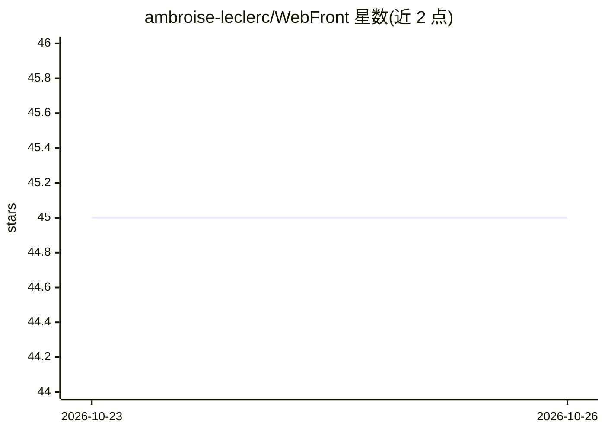

# ambroise-leclerc/WebFront

⭐ 45 · C++ · 推送 2026-10-25 · [GitHub](https://github.com/ambroise-leclerc/WebFront) · 个人维护

**C++23 header-only 库：用 TypeScript/React 构建原生窗口界面**

面向 C++ 开发者的 header-only 界面库：应用逻辑保留在 C++，通过内置的 wf 命令行环境在应用终端内创建、安装依赖并编译 TypeScript/React 界面，无需单独的 Node.js 或 npm 开发环境。支持 Windows WebView2、macOS WKWebView、Linux WebKitGTK 三种原生引擎（可选 CEF），JS 与 C++ 通过 Promise 化的回调桥接，可用 wf embed 将界面打包进 C++ 头文件实现离线分发。构建需 CMake 3.31+ 与 C++23 编译器，README 描述其可被人类与 LLM agent（MCP）脚本化操作；打包、无障碍等仍需应用侧自行处理。

## 筛选速览

| 维度 | 判定 | 备注 |
|---|---|---|
| AI 角色 | `ai-enhanced` | 去掉 AI 部分产品仍成立 |
| 许可风险 | `none` | — |
| 部署形态 | `desktop` | 安装包/桌面程序 |
| 模型依赖 | — | README 未给出锁定关系 |
| 硬件要求 | — | 无带数字的原话,不猜 |
| 安装摩擦 | `medium` | 含编译或系统依赖之一 |
| 成熟度 | — | 结构信号不足 |

## 能力要点

- header-only C++23 库，通过 add_subdirectory 集成，无库二进制需构建
- 内置 wf 命令行：创建项目、锁文件化依赖安装、esbuild-wasm 编译、测试与类型检查
- wf embed 将界面与资源打包为压缩 C++ 头文件，嵌入可执行文件离线分发
- 三平台原生引擎可选：WebView2 / WKWebView / WebKitGTK，另可选 CEF

## 适用场景

- C++ 桌面或嵌入式项目用 React/TypeScript 写界面而逻辑留在 C++
- 无 Node.js/npm 环境的机器上开发和构建前端界面
- 将界面嵌入单一可执行文件做离线分发

## 场景标签

 · 领域:桌面开发/GUI 工具链

## 证据(README 行号)

> L10: **WebFront is a header-only C++23 library for building rich, modern user interfaces.**
> L32: The example starts with a C++ simulation, adds a React interface, then embeds that interface in the executable. You

## 星数曲线

2026-10-23 45 → 2026-10-26 45（+0）

---
*卡片 v1 · prompt 1.4 · 生成 2026-10-25 · 置信度 mid · 依据 README sha `1321ca31c197` · [字段定义](../../DATASET.md)*
