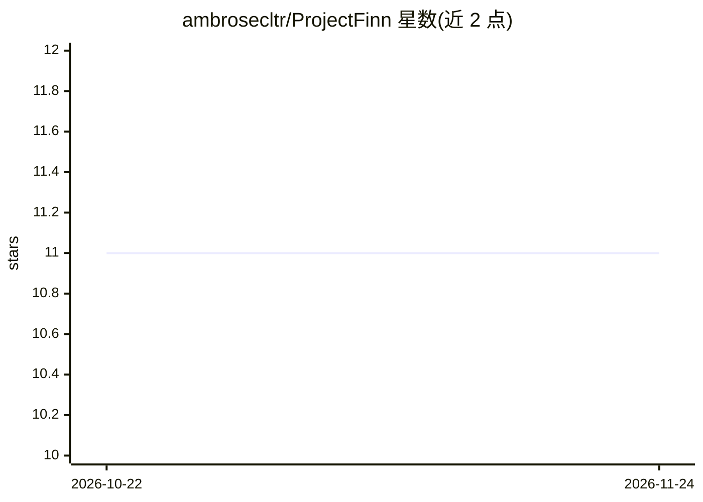

# ambrosecltr/ProjectFinn

⭐ 11 · TypeScript · AGPL-3.0 · 推送 2026-06-24 · [GitHub](https://github.com/ambrosecltr/ProjectFinn) · [官网](https://personalintelligenceproject.com) · 个人维护

**给个人用户：一个住在 iMessage 里的自托管 AI 伴侣**

Finn 是部署在 iMessage 中的个人 AI 伴侣，通过 Spectrum 网关收发短信，用户直接以对话方式获得模型回复、研究、文件处理等结果。热路径由专职 agent 即时回复，慢任务由后台 worker 处理；上下文按需检索加载、历史压缩、工具输出溢出到 artifacts；长期记忆经 Honcho（或 Hindsight/Supermemory/Mem0）接入且不泄漏进聊天。支持 Patterns 定时/触发自动化、Composio/MCP 连接器、Web 控制台与 macOS 配套应用 Puter。需要公网 HTTPS URL，推荐 Docker Compose 部署，采用 AGPL-3.0 许可。

## 筛选速览

| 维度 | 判定 | 备注 |
|---|---|---|
| AI 角色 | `ai-native` | 本体是模型或模型工具 |
| 许可风险 | `viral` | AGPL-3.0 |
| 部署形态 | `self-host` | docker 或自建部署 |
| 模型依赖 | locked-api |  |
| 硬件要求 | — | 无带数字的原话,不猜 |
| 安装摩擦 | `low` | 无编译、无系统依赖或容器化 |
| 成熟度 | — | 结构信号不足 |

## 能力要点

- 热路径 agent 即时回复，慢任务由后台 worker 执行
- 沙箱化 JavaScript 运行时的 code mode（finn 对象 API）
- 长期记忆经 provider 接入，recall 经净化且不向聊天泄漏
- 多用户租户隔离：独立 workspace、作用域连接器、白名单号码

## 适用场景

- 在 iMessage 里与知道我偏好和记忆的 AI 伴侣日常对话
- 给自己或家人朋友各部署一个独立的私人 AI 助手
- 用 Patterns 定时或由连接器触发后台自动化任务

## 场景标签

`AI 助手` `聊天机器人` · 领域:对话与助手

## 证据(README 行号)

> L7: Finn is an AI companion that lives in iMessage. No app to download, no dashboard to learn, no prompts to master. It'
> L18: - **The hot path is always there.** A dedicated agent owns the live thread and replies instantly, while anything sl

## 星数曲线

2026-10-22 11 → 2026-11-24 11（+0）

---
*卡片 v1 · prompt 1.4 · 生成 2026-11-18 · 置信度 high · 依据 README sha `8cf1dc3511d4` · [字段定义](../../DATASET.md)*
