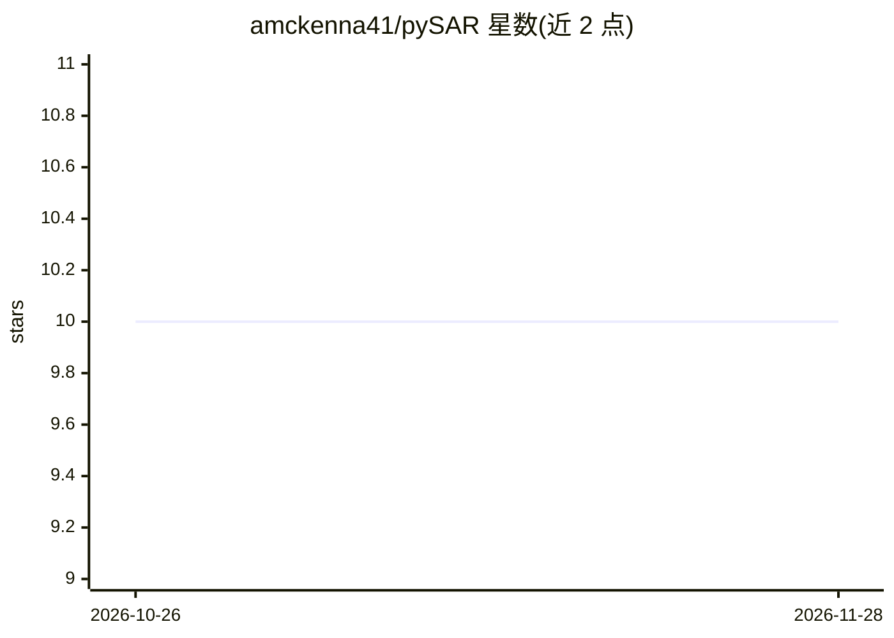

# amckenna41/pySAR

⭐ 10 · Python · MIT · 推送 2026-07-25 · [GitHub](https://github.com/amckenna41/pySAR) · 个人维护

**为蛋白质工程研究者预测蛋白序列活性值的机器学习库**

pySAR 是分析蛋白质序列的序列-活性关系（SAR）与序列-功能关系（SFR）的 Python 库。核心机制：使用 Amino Acid Index (AAI) 数据库（通过自建 aaindex 包）和蛋白描述符（通过自建 protpy 包）将蛋白序列数值化编码，支持 400,000+ 种编码策略，可结合 DSP（FFT 蛋白光谱、窗函数）功能；随后用编码后的特征与体外实验测定的活性值训练回归预测模型，用于预测未见突变序列的活性/适应性值。主要配置通过 JSON 配置文件驱动。使用场景为蛋白质工程、定向进化与药物发现。

## 筛选速览

| 维度 | 判定 | 备注 |
|---|---|---|
| AI 角色 | `ai-native` | 本体是模型或模型工具 |
| 许可风险 | `permissive` | MIT |
| 部署形态 | `library` | 以包/库形式分发 |
| 模型依赖 | — | README 未给出锁定关系 |
| 硬件要求 | — | 无带数字的原话,不猜 |
| 安装摩擦 | `low` | 无编译、无系统依赖或容器化 |
| 成熟度 | — | 结构信号不足 |

## 能力要点

- 通过 AAI 数据库与蛋白描述符编码序列，支持 400,000+ 种编码策略
- 支持 DSP 功能（FFT 蛋白光谱、窗函数、滤波）作为特征生成步骤
- 基于 scikit-learn 构建回归模型预测突变序列活性值
- 配套自建 aaindex 与 protpy 包，可独立使用

## 适用场景

- 定向进化流程中筛选最可能产生目标活性值的突变序列
- 基于体外活性数据为突变文库构建预测模型
- 为蛋白序列批量计算理化与结构描述符特征

## 场景标签

`科研工具` `数据分析` · 领域:效率与自动化

## 证据(README 行号)

> L13: `pySAR` is a Python library for analysing Sequence Activity Relationships (SARs)/Sequence Function Relationships (S
> L32: `pySAR` is a Python library for analysing **Sequence Activity Relationships (SARs)/Sequence Function Relationships*
> L34: After finding the optimal technique and feature set at which to numerically encode your dataset of sequences, `pySA

## 星数曲线

2026-10-26 10 → 2026-11-28 10（+0）

---
*卡片 v1 · prompt 1.4 · 生成 2026-11-20 · 置信度 high · 依据 README sha `2622a1749a21` · [字段定义](../../DATASET.md)*
