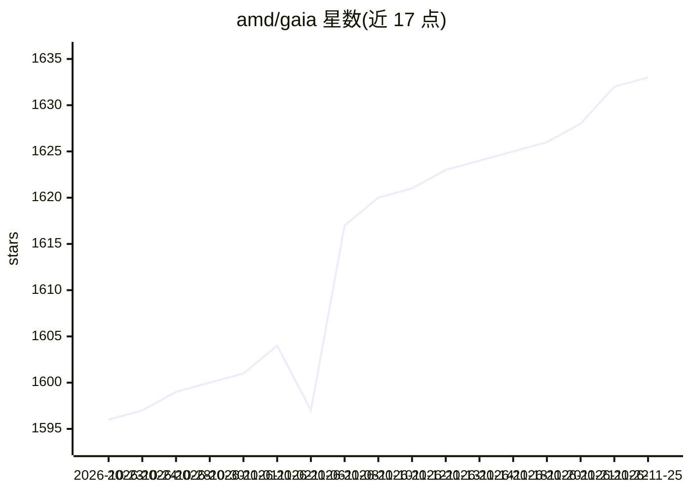

# amd/gaia

⭐ 1,633 · Python · MIT · 推送 2026-11-24 · [GitHub](https://github.com/amd/gaia) · [官网](https://github.com/amd/gaia) · 组织维护

**AMD 面向开发者在 Ryzen AI PC 上本地构建 AI agent 的框架**

GAIA 是 AMD 开源的 agent 构建框架与运行环境：通过 SKILL.md 技能、评测基准和 gaia eval agent --fix 自修复循环构建 agent harness，默认在 AMD Ryzen AI 硬件上本地推理。提供桌面应用与终端 UI 两类入口，底层有 Python（gaiapy）与 C++（gaiacpp）两个可切换 harness，附 Agent SDK 基类、50+ 文件格式的 RAG 索引检索、Whisper/Kokoro 语音与 Qwen3-VL 视觉能力。需 AMD Ryzen AI 300 系列以上处理器，最低 16GB 内存。

## 筛选速览

| 维度 | 判定 | 备注 |
|---|---|---|
| AI 角色 | `ai-ecosystem` | LLM/agent 周边工具 |
| 许可风险 | `permissive` | MIT |
| 部署形态 | `library` | 以包/库形式分发 |
| 模型依赖 | — | README 未给出锁定关系 |
| 硬件要求 | — | 无带数字的原话,不猜 |
| 安装摩擦 | `low` | 无编译、无系统依赖或容器化 |
| 成熟度 | — | 结构信号不足 |

## 能力要点

- Skills + eval 基准 + --fix 自修复循环的 Agent Factory
- Python 与 C++ 两个可互换 harness，C++ 版无 Python 依赖
- RAG 支持 50+ 文件格式的索引与语义检索
- 可选 Fireworks AI / AMD LLM Gateway 云端 chat 及 local_ai_only 网络策略

## 适用场景

- 在 Ryzen AI PC 上离线/气隙环境运行本地 agent
- 用 SDK 构建带工具编排的自定义 agent harness
- 对本地文档做索引与语义问答
- 通过 SKILL.md 无代码扩展 agent 能力

## 场景标签

`Agent 框架` `模型评测` `RAG` · 领域:Agent 开发

## 证据(README 行号)

> L14: **GAIA** is AMD's open-source agent factory. It uses coding-agent skills, evals and an auto-fix loop to improve and
> L48: The SDK is the base layer under the GAIA agent. A minimal harness is a class with a prompt and tools:
> L61: - **Agent Factory** — Skills, an eval benchmark, and `gaia eval agent --fix`, which patches failing scenarios and r

## 星数曲线

2026-10-23 1,596 → 2026-11-25 1,633（+37）

---
*卡片 v1 · prompt 1.4 · 生成 2026-11-23 · 置信度 high · 依据 README sha `ac5bfcc3711f` · [字段定义](../../DATASET.md)*
