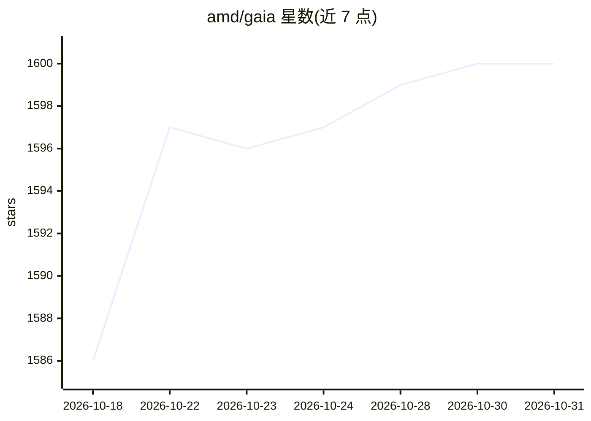

# amd/gaia

⭐ 1,600 · Python · MIT · 推送 2026-10-30 · [GitHub](https://github.com/amd/gaia) · [官网](https://github.com/amd/gaia) · 组织维护

**AMD 开源本地 Agent 工厂：在 Ryzen AI 硬件上构建/运行本地智能体**

AMD 维护的开源 agent 框架，提供 Agent SDK（工具编排、状态管理、错误恢复）、技能系统（SKILL.md 无代码扩展）、评测基准与 gaia eval agent --fix 自动修复循环，用于构建默认本地运行的 agent harness，并附带桌面应用与终端 UI 的 GAIA agent 示例。本地推理基于 Lemonade Server，使用 Ryzen AI 处理器的 NPU + iGPU 加速，支持气隙部署；可选接入 Fireworks AI 与 AMD LLM Gateway 云端对话。另有 C++17 移植版供原生嵌入。系统要求 AMD Ryzen AI 300 系列及以上处理器，推荐 64GB 内存。

## 筛选速览

| 维度 | 判定 | 备注 |
|---|---|---|
| AI 角色 | `ai-ecosystem` | LLM/agent 周边工具 |
| 许可风险 | `permissive` | MIT |
| 部署形态 | `library` | 以包/库形式分发 |
| 模型依赖 | — | README 未给出锁定关系 |
| 硬件要求 | — | 无带数字的原话,不猜 |
| 安装摩擦 | `low` | 无编译、无系统依赖或容器化 |
| 成熟度 | — | 结构信号不足 |

## 能力要点

- Agent SDK 含工具编排、状态管理与错误恢复
- 技能系统用 SKILL.md 无代码扩展 agent 能力
- 评测基准加 gaia eval agent --fix 自动修复循环
- RAG 文档索引支持 50+ 文件格式的语义问答；Whisper ASR + Kokoro TTS 语音交互

## 适用场景

- 在 AMD Ryzen AI PC 上本地构建和运行隐私优先的 AI agent
- 通过技能与评测机制迭代改进自己的 agent harness
- 气隙/离线环境下部署具备 RAG 与语音能力的智能助手

## 场景标签

`Agent 框架` · 领域:Agent 开发

## 证据(README 行号)

> L13: **GAIA** is AMD's open-source agent factory. It uses coding-agent skills, evals and an auto-fix loop to improve and
> L15: Anyone can build an agent harness with GAIA. The **GAIA agent** is the one we built to show what it can do: convers
> L60: - **Agent Factory** — Skills, an eval benchmark, and `gaia eval agent --fix`, which patches failing scenarios and r

## 星数曲线

2026-10-18 1,586 → 2026-10-31 1,600（+14）

---
*卡片 v1 · prompt 1.4 · 生成 2026-10-21 · 置信度 high · 依据 README sha `58e0ff6d4070` · [字段定义](../../DATASET.md)*
