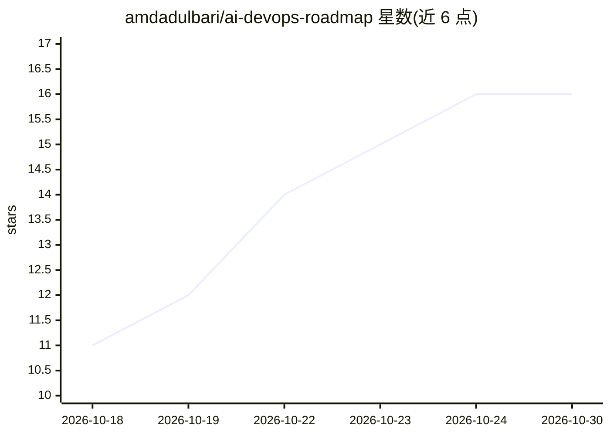

# amdadulbari/ai-devops-roadmap

⭐ 16 · NOASSERTION · 推送 2026-10-19 · [GitHub](https://github.com/amdadulbari/ai-devops-roadmap) · 个人维护

**面向 DevOps/SRE 的 AI 应用实践指南：分级信任+提示词库+安全护栏**

一份人机协同的 AI for DevOps 实践路线图：按七个主题（AI 基础、日常运维、监控、告警事件、CI/CD 与 GitOps、自建助手、生产安全）组织为指南文档，配提示词库、可运行示例、工具目录与术语表。核心机制是 Assist/Gate/Auto 三级信任模型，要求 AI 只做阅读、起草与解释，变更须经过人工或策略检查；并给出最小权限、策略门控、审计日志、提示注入防范等护栏清单。面向 DevOps、平台、SRE 工程师与团队负责人，内容基于 Kubernetes、GitOps、policy as code 与可观测性实践，仓库以阅读文档方式使用，无需安装。

## 筛选速览

| 维度 | 判定 | 备注 |
|---|---|---|
| AI 角色 | `ai-knowledge` | 知识聚合/清单类 |
| 许可风险 | `none` | NOASSERTION |
| 部署形态 | `library` | 以包/库形式分发 |
| 模型依赖 | — | README 未给出锁定关系 |
| 硬件要求 | — | 无带数字的原话,不猜 |
| 安装摩擦 | `low` | 无编译、无系统依赖或容器化 |
| 成熟度 | — | 结构信号不足 |

## 能力要点

- 七个主题指南：从 AI 基础到生产安全
- Assist/Gate/Auto 三级信任模型贯穿全部场景
- 提示词库、可运行示例、工具目录与术语表
- 生产安全护栏清单：最小权限、策略门控、审计日志、kill switch

## 适用场景

- 作为团队引入 AI 到 DevOps 工作的路线图和检查清单
- 直接取用提示词库处理 IaC、告警分诊、事后复盘等日常任务
- 在设计 AI agent 接近生产环境前对照安全护栏评估

## 场景标签

`提示工程` `教程课程` · 领域:Agent 开发

## 证据(README 行号)

> L53: - topics: the seven topic guides, one folder each, from foundations to production safety.
> L56: - tools: a curated catalog of AI-for-DevOps tools, each with a trust level.

## 星数曲线

2026-10-18 11 → 2026-10-30 16（+5）

---
*卡片 v1 · prompt 1.4 · 生成 2026-10-30 · 置信度 high · 依据 README sha `f7694dd2dcaa` · [字段定义](../../DATASET.md)*
