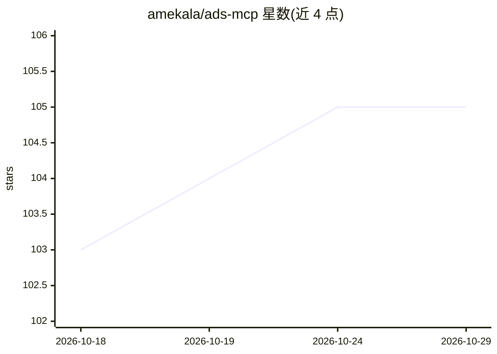

# amekala/ads-mcp

⭐ 105 · Jupyter Notebook · MIT · 推送 2026-10-20 · [GitHub](https://github.com/amekala/ads-mcp) · [官网](https://www.adspirer.com) · 组织维护

**跨平台广告管理的远程 MCP 服务器，供 AI 助手调用 400+ 广告工具**

Adspirer 运营的远程 MCP 服务器（Streamable HTTP、OAuth 2.1+PKCE），将 Google Ads、Meta、TikTok、LinkedIn、Amazon Ads、ChatGPT Ads 六个广告平台的 400+ 工具暴露给任意 MCP 兼容 AI 助手（ChatGPT、Claude、Cursor、Codex、Gemini CLI 等），覆盖campaign 创建、关键词研究、性能分析与浪费支出检测；策略决策持久化到 STRATEGY.md 跨会话生效，新 campaign 默认以暂停状态创建。同一工具面另以 178 个 REST 端点提供。采用免费+订阅分层定价（15–3000 次工具调用/月）。

## 筛选速览

| 维度 | 判定 | 备注 |
|---|---|---|
| AI 角色 | `ai-ecosystem` | LLM/agent 周边工具 |
| 许可风险 | `permissive` | MIT |
| 部署形态 | `None` |  |
| 模型依赖 | locked-api |  |
| 硬件要求 | — | 无带数字的原话,不猜 |
| 安装摩擦 | `low` | 无编译、无系统依赖或容器化 |
| 成熟度 | — | 结构信号不足 |

## 能力要点

- 单一 MCP 服务器覆盖 6 个广告平台的 400+ 工具
- 新 campaign 一律以暂停状态创建，需人工批准才投入花费
- 策略持久化到 STRATEGY.md，指导跨会话与子代理的投放决策
- 同一工具面同时提供 MCP 与 178 个 REST 端点（api.adspirer.ai）

## 适用场景

- 在 Claude/ChatGPT/Cursor 等助手中用自然语言创建与优化跨平台广告
- 投放人员做关键词研究与 CPC 竞价分析
- 代理机构在单一工作区管理多账户多平台广告
- 定时获取跨平台投放简报与异常监控报告

## 场景标签

 · 领域:数字广告/营销自动化

## 证据(README 行号)

> L3: Remote Model Context Protocol (MCP) server for cross-platform ad management. Create, analyze, and optimize campaigns
> L53: - **400+ tools** across 6 ad platforms for campaign creation, performance analysis, and optimization

## 星数曲线

2026-10-18 103 → 2026-10-29 105（+2）

---
*卡片 v1 · prompt 1.4 · 生成 2026-10-23 · 置信度 high · 依据 README sha `16dafe9a45db` · [字段定义](../../DATASET.md)*
