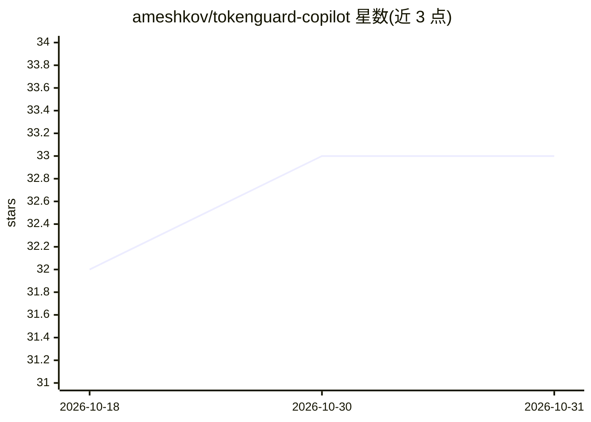

# ameshkov/tokenguard-copilot

⭐ 33 · TypeScript · MIT · 推送 2026-10-08 · [GitHub](https://github.com/ameshkov/tokenguard-copilot) · [官网](https://github.com/ameshkov/tokenguard-copilot) · 组织维护

**让 VS Code Copilot Chat 接入第三方 OpenAI 兼容模型的扩展**

由 AdGuard 团队维护的 VS Code 扩展，面向希望在 Copilot Chat 中使用第三方 OpenAI 兼容端点（OpenRouter、DeepSeek、本地 Ollama 等）的开发者。它处理各模型差异：保留 DeepSeek reasoning_content 流字段、Qwen/Anthropic 的 cache_control 注入、Minimax 工具调用规范化、多轮推理 token 重注入。附带本地 o200k_base token 计数与按日用量/成本统计、models.dev 默认参数快照、Content Rules 正则消息改写、Markdown 调试日志。通过 VS Code Marketplace、Open VSX 或 VSIX 安装。

## 筛选速览

| 维度 | 判定 | 备注 |
|---|---|---|
| AI 角色 | `ai-ecosystem` | LLM/agent 周边工具 |
| 许可风险 | `permissive` | MIT |
| 部署形态 | `desktop` | 安装包/桌面程序 |
| 模型依赖 | local-ok | 支持本地模型 |
| 硬件要求 | — | 无带数字的原话,不猜 |
| 安装摩擦 | `low` | 无编译、无系统依赖或容器化 |
| 成熟度 | — | 结构信号不足 |

## 能力要点

- 兼容任意 OpenAI 兼容 provider，含 OpenRouter/DeepSeek/本地 Ollama
- reasoning 模型支持：effort 映射与跨轮推理 token 保留
- 本地 o200k_base 计数 + provider usage 字段的按日成本统计
- Content Rules：顺序正则改写 system/user 消息

## 适用场景

- 在 Copilot Chat 里改用自选的第三方或本地模型
- 追踪各模型每日 token 用量与成本
- 为特定模型裁剪/改写 Copilot 系统提示词

## 场景标签

`模型网关` · 领域:Agent 开发

## 证据(README 行号)

> L10: TokenGuard Copilot is a VS Code extension for developers who want to use
> L32: > OpenAI-compatible provider** — OpenRouter, DeepSeek, local Ollama, or any

## 星数曲线

2026-10-18 32 → 2026-10-31 33（+1）

---
*卡片 v1 · prompt 1.4 · 生成 2026-10-26 · 置信度 high · 依据 README sha `c582e8e697c0` · [字段定义](../../DATASET.md)*
