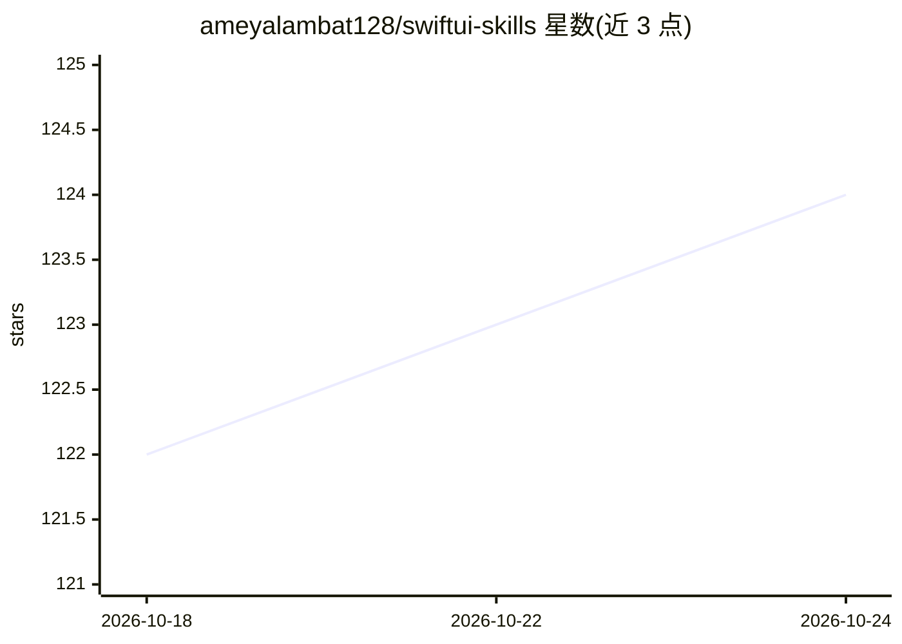

# ameyalambat128/swiftui-skills

⭐ 124 · TypeScript · MIT · 推送 2026-07-06 · [GitHub](https://github.com/ameyalambat128/swiftui-skills) · [官网](https://swiftui-skills.ameyalambat.com) · 个人维护

**把 Xcode 内置 Apple 文档提取为 AI 编码 agent 的 SwiftUI 技能包**

从本地安装的 Xcode 中提取 Apple 官方 SwiftUI 文档，打包为 SKILL.md 格式的技能，供 AI 编码 agent 在生成与审查代码时作为事实来源，用于减少编造或非惯用法的 SwiftUI 代码。提供 curl 一键安装、npm skills TUI、setup.sh 等多种安装途径，内置 Claude Code、Cursor、Codex 的插件清单，并支持 OpenClaw 的技能加载路径。要求 macOS 与 Xcode 26 及以上；不重新分发 Apple 文档，全部在本地提取。

## 筛选速览

| 维度 | 判定 | 备注 |
|---|---|---|
| AI 角色 | `ai-ecosystem` | LLM/agent 周边工具 |
| 许可风险 | `permissive` | MIT |
| 部署形态 | `library` | 以包/库形式分发 |
| 模型依赖 | — | README 未给出锁定关系 |
| 硬件要求 | — | 无带数字的原话,不猜 |
| 安装摩擦 | `low` | 无编译、无系统依赖或容器化 |
| 成熟度 | — | 结构信号不足 |

## 能力要点

- 从本地 Xcode 提取 Apple 官方文档作为 agent 技能
- 内置 Claude Code / Cursor / Codex 插件清单与 OpenClaw 兼容路径
- 文档覆盖 SwiftUI 模式、App Intents、StoreKit、Swift Concurrency、visionOS Widgets 等
- 本地提取、不重新分发 Apple 文档

## 适用场景

- 让 Claude Code / Cursor 等 AI agent 写出惯用的 SwiftUI 代码
- iOS 开发者重构到 SwiftUI 时减少 AI 编造 API
- 开发涉及 App Intents、StoreKit、Widgets、visionOS 的应用

## 场景标签

 · 领域:软件开发/Apple 平台

## 证据(README 行号)

> L9: `/swiftui-skills` extracts internal Apple documentation shipped inside Xcode and turns it into reusable skills that 
> L13: - Works with Claude Code, Cursor, Codex, OpenClaw, and similar tools
> L122: 1. The installer extracts Apple documentation from your local Xcode install.

## 星数曲线

2026-10-18 122 → 2026-10-24 124（+2）

---
*卡片 v1 · prompt 1.4 · 生成 2026-10-23 · 置信度 high · 依据 README sha `4f1ca4838546` · [字段定义](../../DATASET.md)*
