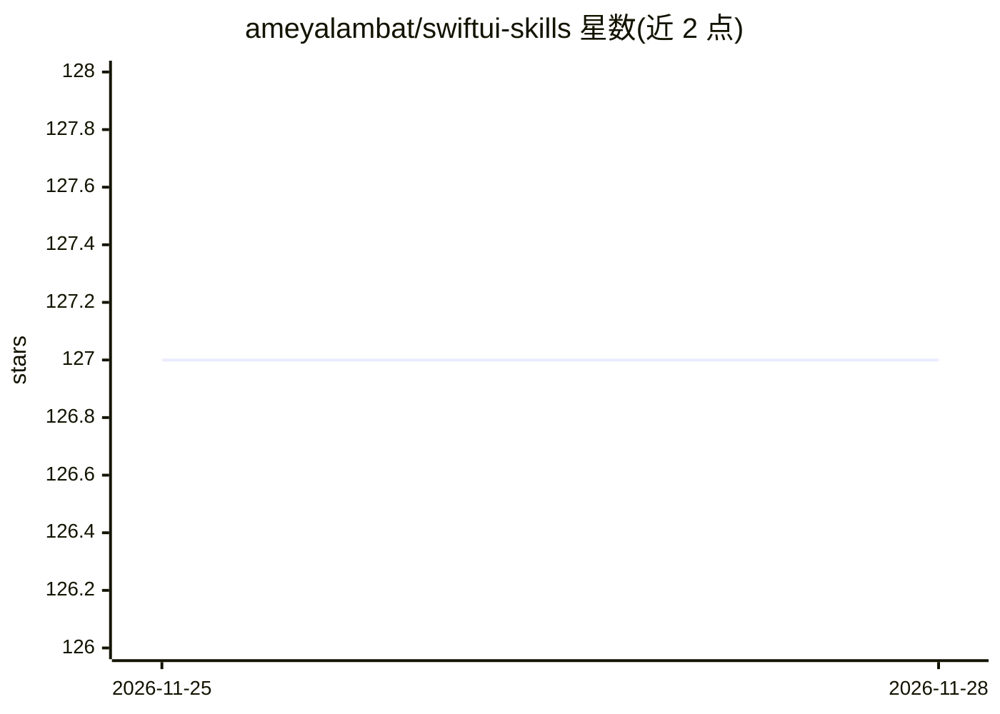

# ameyalambat/swiftui-skills

⭐ 127 · TypeScript · MIT · 推送 2026-11-23 · [GitHub](https://github.com/ameyalambat/swiftui-skills) · [官网](https://swiftui-skills.ameyalambat.com) · 个人维护

**给 AI 编码代理提供 SwiftUI 规范知识的技能包**

从本机 Xcode 内置的 Apple 文档中提取 SwiftUI 与 Apple 平台官方指导，打包为 AI 编码代理可加载的技能（SKILL.md）。不重新分发 Apple 文档，全部在安装时本地提取；技能在代理生成与审查代码时作为事实来源，以减少编造或不符合惯例的 SwiftUI 代码。提供 curl 一键安装、npx TUI 安装、setup.sh，以及 Claude Code/Cursor/Codex 原生插件清单；要求 macOS 与 Xcode 26+。面向用 AI 写 SwiftUI 应用的开发者。

## 筛选速览

| 维度 | 判定 | 备注 |
|---|---|---|
| AI 角色 | `ai-knowledge` | 知识聚合/清单类 |
| 许可风险 | `permissive` | MIT |
| 部署形态 | `library` | 以包/库形式分发 |
| 模型依赖 | — | README 未给出锁定关系 |
| 硬件要求 | — | 无带数字的原话,不猜 |
| 安装摩擦 | `low` | 无编译、无系统依赖或容器化 |
| 成熟度 | — | 结构信号不足 |

## 能力要点

- 从本地 Xcode 提取 Apple 官方文档，生成 agent 可用的技能包
- 提供 Claude Code、Cursor、Codex 原生插件清单
- 覆盖 SwiftUI、App Intents、StoreKit、SwiftData、visionOS Widgets 等主题
- 本地优先，不重新分发 Apple 文档

## 适用场景

- 让 AI 代理按 Apple 官方惯例编写 SwiftUI 代码
- 把现有项目重构为 SwiftUI 时为代理提供官方指导
- 使用 App Intents、StoreKit、visionOS Widgets 开发时查证 API 用法

## 场景标签

`提示工程` · 领域:Agent 开发

## 证据(README 行号)

> L3: Apple-authored SwiftUI and Apple platform guidance, packaged as skills for AI coding agents.
> L9: `/swiftui-skills` extracts internal Apple documentation shipped inside Xcode and turns it into reusable skills that 
> L122: 1. The installer extracts Apple documentation from your local Xcode install.

## 星数曲线

2026-11-25 127 → 2026-11-28 127（+0）

---
*卡片 v1 · prompt 1.4 · 生成 2026-11-24 · 置信度 high · 依据 README sha `7796a30dfa6c` · [字段定义](../../DATASET.md)*
