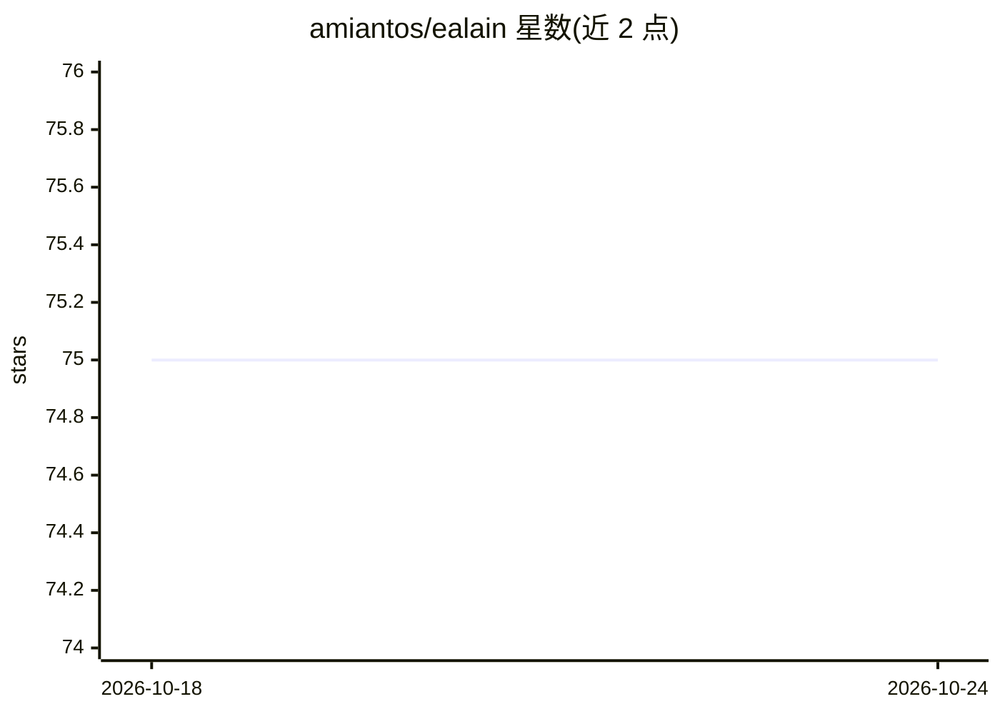

# amiantos/ealain

⭐ 75 · C# · MPL-2.0 · 推送 2026-08-03 · [GitHub](https://github.com/amiantos/ealain) · 个人维护

**用 Stable Diffusion 生成抽象艺术画面的 macOS/Windows 屏保**

面向 macOS 与 Windows 的屏幕保护程序：通过 AI Horde 分布式 GPU 网络免费生成包豪斯/风格派风格的抽象艺术图像，旧图随时间被新图替换，每次运行呈现不同画面。支持自定义 AI Horde Styles 风格并可通过 PR 提交，自动检测横竖屏显示器并按 16:9 或 9:16 生成，本地文件系统缓存约 100-200 张图像。以 macOS 与 Windows 安装包形式提供下载，采用 Mozilla Public License 2.0 许可。

## 筛选速览

| 维度 | 判定 | 备注 |
|---|---|---|
| AI 角色 | `ai-native` | 本体是模型或模型工具 |
| 许可风险 | `permissive` | MPL-2.0 |
| 部署形态 | `None` |  |
| 模型依赖 | — | README 未给出锁定关系 |
| 硬件要求 | — | 无带数字的原话,不猜 |
| 安装摩擦 | `low` | 无编译、无系统依赖或容器化 |
| 成熟度 | — | 结构信号不足 |

## 能力要点

- 通过 AI Horde 分布式 GPU 网络免费生成图像
- 支持自定义 AI Horde Styles 风格
- 横竖屏检测，按 16:9 或 9:16 生成
- 本地缓存 100-200 张图像

## 适用场景

- 让屏幕保护程序持续展示生成式抽象艺术
- 自定义风格生成个性化屏保画面
- 横竖屏多显示器环境下的动态屏保

## 场景标签

`图像生成` · 领域:内容生成

## 证据(README 行号)

> L3: Ealain is a screensaver for macOS and Windows that displays abstract art generated with Stable Diffusion using the A
> L18: Ealain uses the AI Horde to generate the art, for free, using GPUs located all around the world. Older images are r

## 星数曲线

2026-10-18 75 → 2026-10-24 75（+0）

---
*卡片 v1 · prompt 1.4 · 生成 2026-10-24 · 置信度 high · 依据 README sha `b55672a8730d` · [字段定义](../../DATASET.md)*
