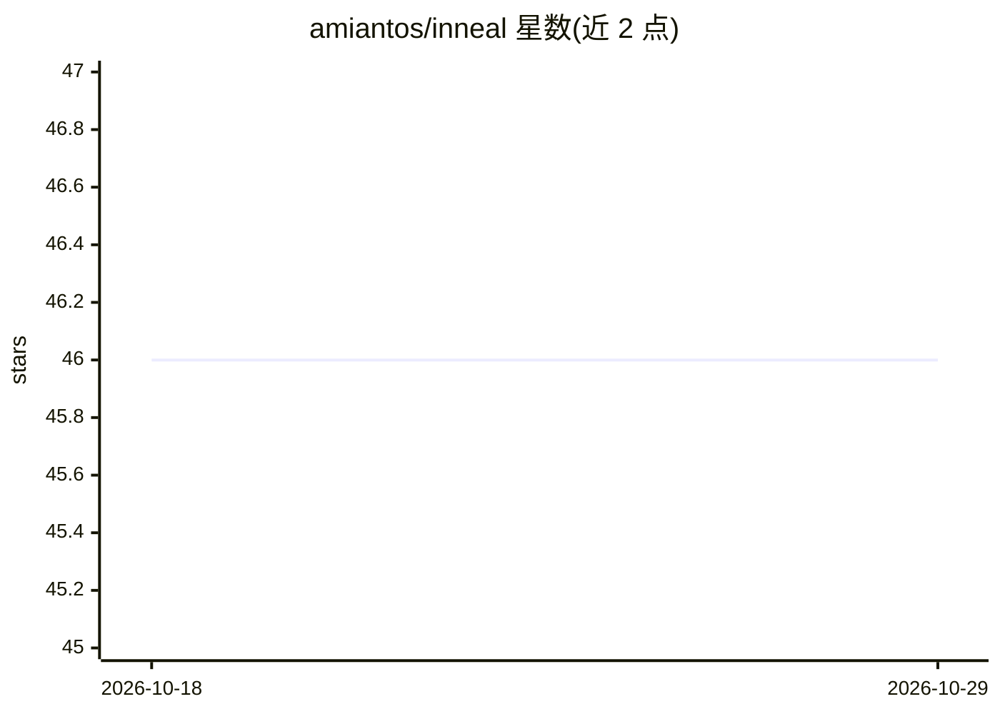

# amiantos/inneal

⭐ 46 · Swift · GPL-3.0 · 推送 2026-09-13 · [GitHub](https://github.com/amiantos/inneal) · 个人维护

**面向 AI Horde 的 LLM 角色扮演聊天客户端（Apple 平台）**

基于 SwiftUI 和 SwiftData 构建的 LLM 聊天/角色扮演客户端，面向 Apple 设备用户，通过 AI Horde 群众众包推理网络获取模型输出。支持自建聊天机器人或导入 Tavern 角色卡、多角色聊天、Persona、自动模式的 AI Horde 调度，以及 CloudKit 跨设备同步聊天与角色。通过 TestFlight 测试版或 App Store 购买获取，开发需 Xcode 15.3+ 从源码构建。GPL-3.0 许可，由个人维护。

## 筛选速览

| 维度 | 判定 | 备注 |
|---|---|---|
| AI 角色 | `ai-native` | 本体是模型或模型工具 |
| 许可风险 | `viral` | GPL-3.0 |
| 部署形态 | `None` |  |
| 模型依赖 | — | README 未给出锁定关系 |
| 硬件要求 | — | 无带数字的原话,不猜 |
| 安装摩擦 | `low` | 无编译、无系统依赖或容器化 |
| 成熟度 | — | 结构信号不足 |

## 能力要点

- 通过 AI Horde 获取 LLM 推理，Auto Mode 自动调度
- 自建聊天机器人或导入 Tavern 角色卡
- 多角色聊天与 Persona 支持
- CloudKit 跨设备同步聊天与角色

## 适用场景

- 在 iPhone/iPad 上与自定义角色进行 LLM 对话或角色扮演
- 导入 Tavern 角色卡延续已有角色设定
- 多设备间同步聊天记录与角色

## 场景标签

`聊天机器人` · 领域:对话与助手

## 证据(README 行号)

> L3: Inneal is a LLM roleplay chatbot client for the AI Horde, built for Apple devices.
> L12: - [x] "Auto Mode" takes the guesswork out of using the AI Horde, so you can get to chatting

## 星数曲线

2026-10-18 46 → 2026-10-29 46（+0）

---
*卡片 v1 · prompt 1.4 · 生成 2026-10-25 · 置信度 high · 依据 README sha `fce8b6b06cc2` · [字段定义](../../DATASET.md)*
