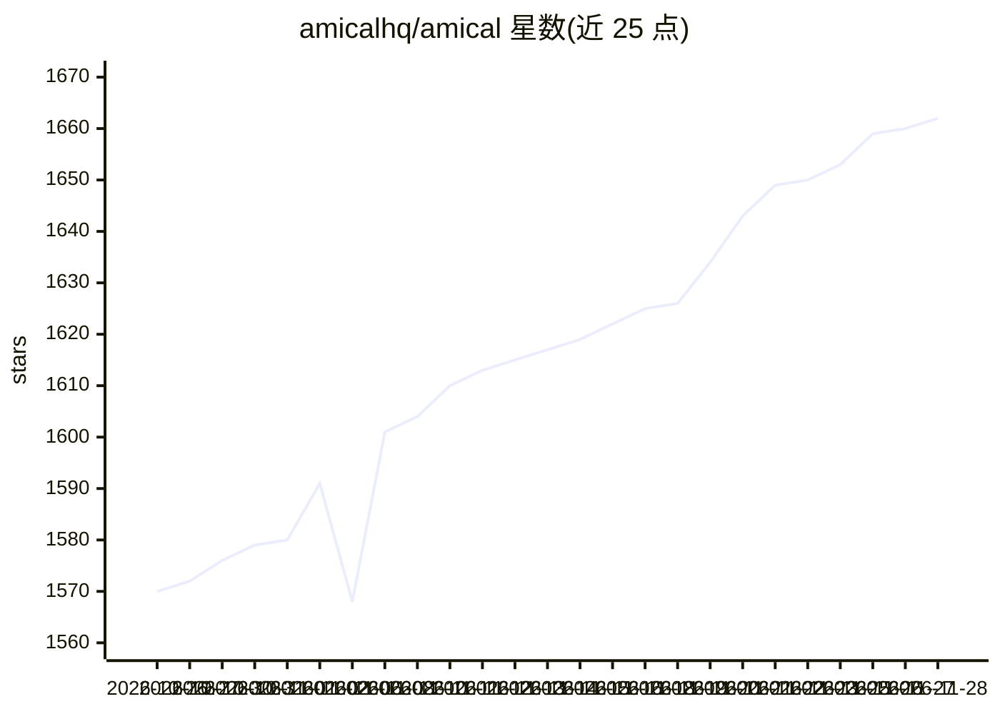

# amicalhq/amical

⭐ 1,662 · TypeScript · MIT · 推送 2026-11-24 · [GitHub](https://github.com/amicalhq/amical) · [官网](https://amical.ai) · 组织维护

**面向普通用户的 macOS/Windows 免费开源离线语音输入应用**

Amical 是一款 macOS 与 Windows 桌面语音听写应用：按住按键说话，文字即插入任意应用的当前光标处。本地语音模型（Parakeet v3 与多档 Whisper）由 whisper.cpp 推理，macOS 走 Metal、Windows 走 Vulkan GPU 加速，首次下载模型后可完全离线工作，最多支持 99 种语言。另支持自定义词汇/替换、语音片段、Markdown 笔记、转录历史回放，并可接入 Ollama 或 OpenAI 兼容服务对文本按当前应用做格式化。提供 dmg/exe 安装包、Homebrew cask 与 iOS/Android 版本；Linux 尚无原生 helper 不受支持。

## 筛选速览

| 维度 | 判定 | 备注 |
|---|---|---|
| AI 角色 | `ai-native` | 本体是模型或模型工具 |
| 许可风险 | `permissive` | MIT |
| 部署形态 | `desktop` | 安装包/桌面程序 |
| 模型依赖 | local-ok | 支持本地模型 |
| 硬件要求 | — | 无带数字的原话,不猜 |
| 安装摩擦 | `high` | 编译与系统依赖俱全 |
| 成熟度 | — | 结构信号不足 |

## 能力要点

- 本地 Whisper/Parakeet 模型离线转录，whisper.cpp 推理并支持 Metal/Vulkan GPU 加速
- 推送说话/免手/悬浮窗三种触发方式，转录可粘贴到任意应用
- 自定义词汇表、替换规则、语音片段触发与转录历史
- 可连接 Ollama、LM Studio 或 OpenRouter 做 AI 格式化

## 适用场景

- 在任何应用中用语音替代键盘输入
- 无网络或不想使用云服务的环境做本地听写
- 为邮件/聊天/笔记场景定制术语与文本格式化
- 用语音片段快速插入会议链接或地址等常用文本

## 场景标签

`语音识别` · 领域:感知与多模态

## 证据(README 行号)

> L19:  Free, open source voice typing for macOS and Windows.
> L73: Amical downloads a speech model once, then transcribes on your computer, also
> L95: Amical runs these models with whisper.cpp,

## 星数曲线

2026-10-26 1,570 → 2026-11-28 1,662（+92）

---
*卡片 v1 · prompt 1.4 · 生成 2026-11-23 · 置信度 mid · 依据 README sha `e61db3e30afa` · [字段定义](../../DATASET.md)*
