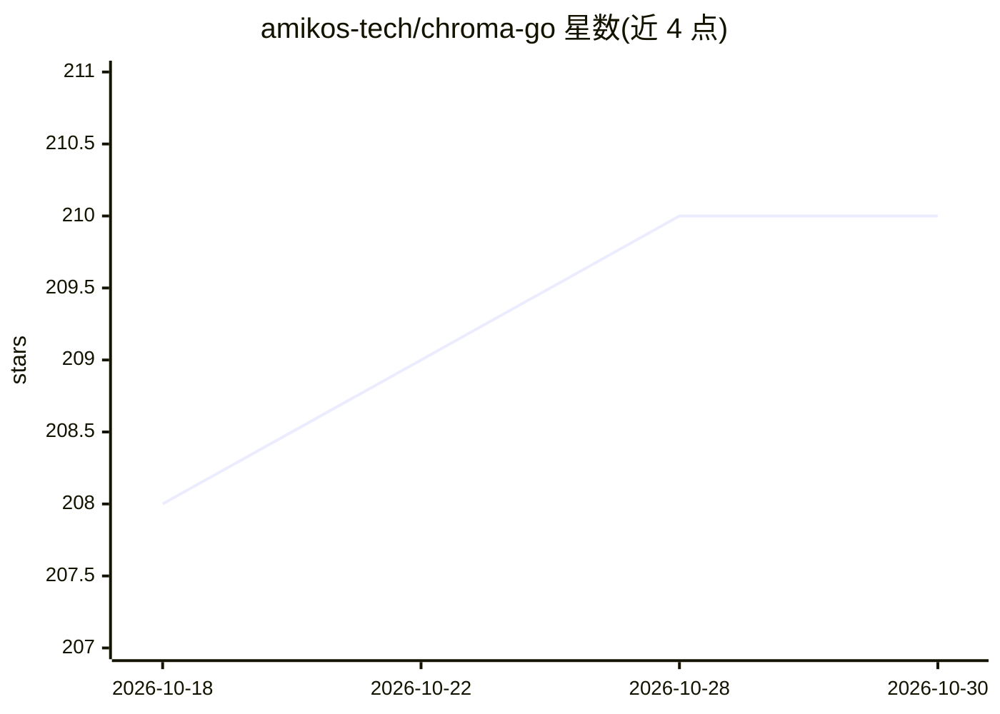

# amikos-tech/chroma-go

⭐ 210 · Go · MIT · 推送 2026-10-28 · [GitHub](https://github.com/amikos-tech/chroma-go) · [官网](https://go-client.chromadb.dev) · 组织维护

**Chroma 向量数据库的 Go 客户端库**

用 Go 编写的 Chroma 向量数据库客户端库，v0.3.x/v0.4.x 兼容 Chroma v1.x（CI 测试至 1.5.5）。支持 HTTP 连接自托管服务器、Chroma Cloud 以及进程内持久化客户端（首次使用时自动下载 shim 原生库并缓存）。内置约 20 家厂商的 Embedding 函数适配（OpenAI/Cohere/Gemini/Ollama/Bedrock 等），含多模态 Content API、稀疏向量（BM25/Splade）、重排序函数与结构化日志。离线环境可用脚本预下载运行时依赖。面向在 Go 应用中接入 Chroma 的开发者，通过 go get 安装。

## 筛选速览

| 维度 | 判定 | 备注 |
|---|---|---|
| AI 角色 | `ai-ecosystem` | LLM/agent 周边工具 |
| 许可风险 | `permissive` | MIT |
| 部署形态 | `self-host` | docker 或自建部署 |
| 模型依赖 | local-ok | 支持本地模型 |
| 硬件要求 | — | 无带数字的原话,不猜 |
| 安装摩擦 | `low` | 无编译、无系统依赖或容器化 |
| 成熟度 | — | 结构信号不足 |

## 能力要点

- 持久化客户端可在 Go 进程内嵌入运行 Chroma，无需外部服务器
- 约 20 家厂商 Embedding 适配，含多模态（文本/图像/音频/视频/PDF）
- 稀疏向量（BM25/Splade）与重排序函数（Cohere/Jina/HFEI/Together）
- 离线/气隙环境的运行时依赖预下载脚本

## 适用场景

- Go 服务中接入自托管或云端 Chroma 做向量存取与检索
- 在 Go 应用内嵌入运行 Chroma，免除独立数据库进程
- 统一接入多家 Embedding 厂商并做多模态向量化

## 场景标签

`向量数据库` · 领域:知识与检索

## 证据(README 行号)

> L3: A simple Chroma Vector Database client written in Go.
> L161: - ✅ Persistent Client support - Run/embed full-featured Chroma in your Go application without running an external

## 星数曲线

2026-10-18 208 → 2026-10-30 210（+2）

---
*卡片 v1 · prompt 1.4 · 生成 2026-10-22 · 置信度 mid · 依据 README sha `1faefaf849d6` · [字段定义](../../DATASET.md)*
